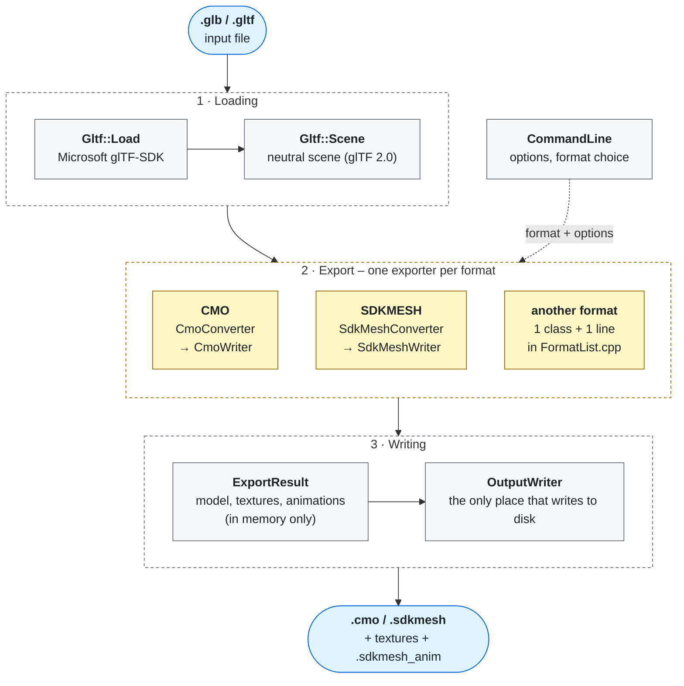

# GlbToMesh

A console application for **Windows** (modern **C++20**, a project for **Visual Studio 2026 Community**) that converts
**glTF 2.0** models (`.glb`, and `.gltf` with external files or data URIs) to Direct3D mesh formats, including **materials,
textures, hierarchy, skeletons, skinning and animations**. It currently writes two output formats:

| Format      | Extension  | What is written                                                                                                                                                                                  |
| ----------- | ---------- | ------------------------------------------------------------------------------------------------------------------------------------------------------------------------------------------------ |
| **CMO**     | `.cmo`     | *Visual Studio Compiled Mesh Object* (Starter Kit, DirectXTK `Model::CreateFromCMO`): meshes with baked world matrices, materials, textures, skeleton, skinning, animations (stored in the file) |
| **SDKMESH** | `.sdkmesh` | *DirectX SDK Mesh* version 101 (Blinn-Phong) or 200 (PBR) – DXUT, DirectXTK `Model::CreateFromSDKMESH`: frame hierarchy, materials, textures, skinning, and animations in `.sdkmesh_anim` files  |

The program is built so that **another output format can be added later** without touching the rest of the program: a new format is
one class and one line in the format list, see [How to add another output format](#how-to-add-another-output-format).

glTF is read with **Microsoft glTF-SDK** (`GLBResourceReader`, `GLTFResourceReader`, `Deserialize`), which is bundled in
`GlbToMesh\glTF-SDK` (with RapidJSON) and built as a static library inside the solution. The output files are written by our own
writers modelled on `CMO.h`, `SDKMesh.h` and the DirectXTK loaders, including the same limit checks the loaders make (counts of
meshes, materials and buffers, vertex declarations, links between frames), so the program does not produce a file DirectXTK would
reject.

The opposite direction (CMO / SDKMESH → GLB) is done by the separate program `MeshToGlb`.

## Building (Visual Studio 2026)

All that is needed is Visual Studio 2026 Community with the **Desktop development with C++** workload (MSVC v145 tools, Windows SDK).
No other libraries or NuGet packages; everything required is in `GlbToMesh\glTF-SDK`.

1. Open `GlbToMesh.slnx`.
2. Select **Debug | x64** or **Release | x64** (both projects have configurations for x64 only; the solution file lists an x86 platform,
   but no project has a configuration for it) and *Build → Build Solution* (`Ctrl+Shift+B`).
3. Result: `GlbToMesh.exe` in the default Visual Studio output folder (e.g. `x64\Release\` next to `GlbToMesh.slnx`).

Cleaning up: `clean.bat` in the root deletes the `.vs` folder and every `x64` folder (build results and intermediate files) and waits
for a key at the end.

What the solution contains:

| Project     | Type                                  | Notes                                                                                                                                                        |
| ----------- | ------------------------------------- | ------------------------------------------------------------------------------------------------------------------------------------------------------------ |
| `GlbToMesh` | console application (startup project) | `main.cpp`, `CommandLine.*`, `core\`, `formats\`; entry point `wmain` (arguments and file names are converted from UTF-16 to UTF-8, so non-ASCII names work) |
| `glTF-SDK`  | static library                        | `GlbToMesh\glTF-SDK\Src\*.cpp` (Microsoft glTF-SDK, unmodified); RapidJSON is in `RapidJson`                                                                 |

Settings of the `GlbToMesh` project: `PlatformToolset v145`, `/std:c++20`, conformance mode (`/permissive-`), warning level `/W3`.
glTF-SDK headers are written in the code as `<glTF-SDK/Inc/...>` and are looked up from the project folder (*Additional Include
Directories*: `$(ProjectDir);$(SolutionDir);$(SolutionDir)gltf-SDK`).
Sources are UTF-8 with BOM and LF line endings; formatting is defined by `.clang-format` in the root. The C++ runtime is left at the
Visual Studio default (dynamic CRT), so another computer needs the *Microsoft Visual C++ Redistributable*; for a dependency-free
program switch *Properties → C/C++ → Code Generation → Runtime Library* to `/MT`. Debug arguments are set in *Properties →
Debugging → Command Arguments*.

From the command line (*Developer Command Prompt*): `msbuild GlbToMesh.slnx /p:Configuration=Release /p:Platform=x64 /m`.

## Usage

```
GlbToMesh <model.glb|model.gltf> [output] [options]
```

The output format is chosen by the **extension of the output file** (`.cmo`, `.sdkmesh`); `--format` forces it. If no output file is
given, the input name with the format's extension is used, and that works only with `--format` (otherwise the program does not know
where to write). The input is recognised by its content, not by its extension.

Common options:

| Option                | Meaning                                                                                                                                                                                                            |
| --------------------- | ------------------------------------------------------------------------------------------------------------------------------------------------------------------------------------------------------------------ |
| `-o, --output <file>` | output file (default: the input name with the format's extension; needs `--format`)                                                                                                                                |
| `-f, --format <name>` | output format (`CMO`, `SDKMESH`; default: from the extension of the output file)                                                                                                                                   |
| `--list-formats`      | list the supported formats                                                                                                                                                                                         |
| `--no-anim`           | export without animations (skeleton and skinning are kept)                                                                                                                                                         |
| `--no-textures`       | do not write texture files; materials are exported without textures                                                                                                                                                |
| `--texture-dir <dir>` | directory for the texture files (default: the directory of the output file); the model refers to textures by file name only                                                                                        |
| `--left-handed`       | write the model in the left-handed Direct3D system → mirror the Z axis                                                                                                                                             |
| `--right-handed`      | write the model right-handed like glTF → do not mirror. Without either option the format decides (both CMO and SDKMESH default to right-handed). The triangle winding is always written the way the format expects |
| `--srgb-colors`       | write material colors as sRGB (glTF has them linear; for loading with `ModelLoader_MaterialColorsSRGB`)                                                                                                            |
| `-v, --verbose`       | print details                                                                                                                                                                                                      |
| `-h, --help`          | help (including the options and notes of each format)                                                                                                                                                              |

Options of the CMO format:

| Option                  | Meaning                                                                                                      |
| ----------------------- | ------------------------------------------------------------------------------------------------------------ |
| `--pixel-shader <name>` | pixel shader name stored in the materials (default: none, so `DGSLEffectFactory` uses its built-in material) |

Options of the SDKMESH format:

| Option              | Meaning                                                                                                                                                                                                                                                          |
| ------------------- | ---------------------------------------------------------------------------------------------------------------------------------------------------------------------------------------------------------------------------------------------------------------- |
| `--anim-fps <n>`    | keys per second in the `.sdkmesh_anim` files (default 30, 1 to 1000)                                                                                                                                                                                             |
| `--pbr`             | write SDKMESH **version 200** with PBR materials (albedo, normal, RMA, emissive texture; loaded by `PBREffectFactory`) instead of version 101 (Blinn-Phong)                                                                                                      |
| `--bake-transforms` | bake the node transforms of static meshes into their vertices (world coordinates, the mesh hangs on a frame with an identity matrix) for viewers that ignore the frame matrices; animated nodes are not baked. See [Loading in DirectXTK](#loading-in-directxtk) |

An option of a format that was not selected is a **usage error** (code 2), and the message names the format it belongs to. The values
of format options are checked before the input is read.

Exit codes: `0` OK, `1` error while reading or converting, `2` usage error (invalid options).

```
GlbToMesh hero.glb hero.cmo                                 # hero.cmo + textures next to it
GlbToMesh hero.glb hero.sdkmesh --pbr                       # version 200 for PBREffectFactory
GlbToMesh level.glb level.sdkmesh --bake-transforms         # static meshes in world coordinates
GlbToMesh hero.gltf out\hero.sdkmesh --texture-dir out\textures --srgb-colors
GlbToMesh hero.glb --format sdkmesh                         # hero.sdkmesh next to the input
```

With SDKMESH every glTF animation becomes one file next to the model: a single animation is called `model.sdkmesh_anim` (what DXUT
expects), several animations `model_<animation name>.sdkmesh_anim`.

### Conversion examples

The examples use real models. `GlbToMesh.exe` is run in the folder of the input file and the output is written next to it. File names
containing a space have to be quoted. The listings are shortened (omitted lines are marked `…`).

**A character with a skeleton and animations → CMO.** `hero.glb` has 69 nodes, 24 meshes, 20 materials with textures, one skin
and 21 animations:

```
GlbToMesh.exe hero.glb --format CMO --left-handed
```

```
Reading hero.glb
  glTF: 69 nodes, 24 meshes (38 primitives), 20 materials, 20 images, 1 skins, 21 animations
Warning: 4 animation channels were not exported: CMO animates only the bones of skinned meshes (no animation of plain nodes or morph target weights).
Warning: 5 primitives have morph targets, which CMO does not support - only the base shape is exported.
Written hero.cmo (2591146 bytes): 24 meshes (1 skinned), 38 submeshes, 6380 vertices, 2879 triangles, 38 materials, 20 textures, 43 bones, 17 animation clips (28956 keys)
2 warning(s) - see above.
```

This writes `hero.cmo` and, next to it, 20 PNG texture files (the animation clips are inside the `.cmo`). No output file is given,
so `--format` is required; the output name is taken from the input. Use `--left-handed` if the application works in a left-handed
coordinate system (`XMMatrixLookAtLH` etc.). Both warnings are only notices (the exit code is 0): CMO cannot animate plain nodes, only the
bones of skinned meshes, nor morph targets.

**The same to SDKMESH, with baked transforms:**

```
GlbToMesh.exe hero.glb --format SDKMESH --left-handed --bake-transforms
```

```
Reading hero.glb
  glTF: 69 nodes, 24 meshes (38 primitives), 20 materials, 20 images, 1 skins, 21 animations
Warning: Some materials are double-sided; SDKMESH has no such flag, so DirectXTK draws them single-sided (draw the model with culling disabled if needed).
Warning: 4 animation channels were not exported (nodes outside of the exported scene, morph target weights or duplicate channels).
Warning: 5 primitives have morph targets, which SDKMESH does not support - only the base shape is exported.
Written ./hero_chuze-pom01.sdkmesh_anim (80536 bytes): animation 'chuze-pom01', 43 tracks, 44 keys at 30 per second
…
Written ./hero_zas-tel01.sdkmesh_anim (106336 bytes): animation 'zas-tel01', 43 tracks, 59 keys at 30 per second
Written hero.sdkmesh (317496 bytes, SDKMESH 101): 94 frames, 24 meshes (1 skinned), 24 vertex buffers, 38 subsets, 6380 vertices, 2879 triangles, 21 materials, 20 textures, 17 animations (62006 keys), 23 baked into world coordinates
3 warning(s) - see above.
```

Each of the 17 animations is a separate file `hero_<animation name>.sdkmesh_anim`. The summary at the end says that **23 of the
24 meshes** (all the non-skinned ones) were baked into world coordinates; the skinned mesh stayed unchanged. The model therefore stands
in the right place even in a viewer that does not use the frame matrices (see [Loading in DirectXTK](#loading-in-directxtk)). The warning
about double-sided materials means that SDKMESH has no `doubleSided` flag; to see them from both sides the application has to turn
back-face culling off.

**A model with a space in its name and a single animation → SDKMESH.** `Crouch Walk Forward.glb` (the *Maria* character from Mixamo)
has two skinned meshes, one material and an animation called `mixamo.com`:

```
GlbToMesh.exe "Crouch Walk Forward.glb" --format SDKMESH --left-handed
```

```
Reading Crouch Walk Forward.glb
  glTF: 68 nodes, 2 meshes (2 primitives), 1 materials, 2 images, 1 skins, 1 animations
Warning: Some materials are double-sided; SDKMESH has no such flag, so DirectXTK draws them single-sided (draw the model with culling disabled if needed).
Written ./Crouch Walk Forward.sdkmesh_anim (106120 bytes): animation 'mixamo.com', 65 tracks, 38 keys at 30 per second
Written Crouch Walk Forward.sdkmesh (719968 bytes, SDKMESH 101): 71 frames, 2 meshes (2 skinned), 2 vertex buffers, 2 subsets, 9626 vertices, 14646 triangles, 1 materials, 2 textures, 1 animations (2470 keys)
1 warning(s) - see above.
```

The single animation is named after the model (`Crouch Walk Forward.sdkmesh_anim`, as DXUT expects) although it is called `mixamo.com`
in the glTF. The textures `maria_diffuse.png` and `maria_normal.png` are written next to the model. With this model a problem with the
green channel of the normal map may appear after loading, see [Normal maps and the green channel G](#normal-maps-and-the-green-channel-g).

**More variants:**

```
GlbToMesh.exe "Crouch Walk Forward.glb" "Crouch Walk Forward.cmo"                                    # format by extension
GlbToMesh.exe "Crouch Walk Forward.glb" out\Maria.sdkmesh --texture-dir out\textures --no-anim       # textures into another folder, no animations
GlbToMesh.exe --list-formats                                                                         # lists CMO and SDKMESH
```

The second command writes `out\Maria.sdkmesh` and the textures into `out\textures`. The model refers to the textures by file name
only, so the application has to use `fx.SetDirectory(L"out\\textures")`.

**Incorrect usage** ends with code 2 and the message says what is wrong (an option belongs to another format; the format cannot be determined):

```
GlbToMesh.exe "Crouch Walk Forward.glb" --format CMO --bake-transforms
Error: The option --bake-transforms is not supported by the format CMO (it belongs to SDKMESH)

GlbToMesh.exe "Crouch Walk Forward.glb"
Error: Cannot tell the output format: give the output file with a known extension or use --format (supported formats: CMO, SDKMESH)
```

### Loading in DirectXTK

Both formats store only texture file names; the textures are written next to the model (or into `--texture-dir`) and the effect
factory looks for them in the directory set with `SetDirectory`.

**CMO:**

```cpp
DGSLEffectFactory fx(device);
fx.SetDirectory(L"assets");
auto model = Model::CreateFromCMO(device, L"assets\\hero.cmo", fx);   // default ModelLoader_CounterClockwise
```

The triangle winding is clockwise (as Visual Studio writes it), so the default flags of `CreateFromCMO` are correct. For a model made
with `--srgb-colors` add `ModelLoader_MaterialColorsSRGB`; for a model with a skeleton add `ModelLoader_IncludeBones` (without it the
skeleton is not loaded). The clips are stored after the mesh data (the offset is returned in the `animsOffset` parameter); DirectXTK
does not play them, the application code does (e.g. the Starter Kit). If the application uses left-handed matrices
(`XMMatrixLookAtLH` etc.), make the model with `--left-handed`.

**SDKMESH:**

```cpp
EffectFactory fx(device);
fx.SetDirectory(L"assets");
auto model = Model::CreateFromSDKMESH(device, L"assets\\hero.sdkmesh", fx,
                                      ModelLoader_CounterClockwise | ModelLoader_IncludeBones);
```

- The triangles are written **clockwise when seen from outside** (like DXUT files and `tank.sdkmesh`), so the model is loaded with
  `ModelLoader_CounterClockwise` (back-face culling). This also holds for `--left-handed` if the application uses left-handed
  matrices (`XMMatrixLookAtLH` etc.). The default `ModelLoader_Clockwise` is meant for DXUT files drawn in a right-handed application,
  such as `soldier.sdkmesh`.
- `ModelLoader_IncludeBones` is needed to load the frame hierarchy (`Model::bones`) and the skeleton for skinning. For a model made
  with `--srgb-colors` add `ModelLoader_MaterialColorsSRGB`.
- A version 200 file (`--pbr`) is loaded by `PBREffectFactory` instead of `EffectFactory`.
- **A viewer that does not use the frame matrices.** DirectXTK applies the frame matrices (node transforms) only when drawing with bone
  matrices: `ModelLoader_IncludeBones`, `Model::CopyAbsoluteBoneTransformsTo` and `Model::Draw` with an array of bone matrices. A viewer
  that draws the model without them (some report this as "Ignoring model bones") draws every mesh in its local coordinates. Skinned
  meshes are not affected, because they are written in world coordinates, but **static meshes with a node transform** appear in the
  wrong place. Typically these are objects moved in Blender (*Selection to Cursor* moves the object, not its vertices). Convert such a
  model with `--bake-transforms`; in a viewer that does use the frame matrices it looks the same as without it.
- The animation is loaded and played by the application code – see the DirectXTK lessons
  [Animating using model bones](https://github.com/microsoft/DirectXTK/wiki/Animating-using-model-bones) and
  [Using skinned models](https://github.com/microsoft/DirectXTK/wiki/Using-skinned-models) (class `DX::AnimationSDKMESH`:
  `Load(L"hero.sdkmesh_anim")`, `Bind(*model)`, `Update(dt)`). Animations are matched to frames by their **names**, so the names
  in the model are not changed.

## Normal maps and the green channel G

A common visual problem after conversion: **the relief of the texture is lit upside down**. A typical example is `Crouch Walk Forward.glb`
(the *Maria* character from Mixamo, a single material `MariaMat`, textures `maria_diffuse.png` and `maria_normal.png`).

**Symptom.** After loading the resulting `.sdkmesh` or `.cmo` in a Direct3D application the surface is lit wrongly: folds, the armor
ornaments, the shield and the sword look pressed in instead of raised, and there are conspicuously dark areas on the surfaces. The
diffuse texture is fine; the normal map is the culprit.

**Cause.** A normal map stores the direction of the normal in colors: R = X axis, G = Y axis, B = Z axis (which is why the map is mostly
blue-violet). The vertical component is carried by the **G** channel, the "green" one, and the two conventions have it the opposite
way: glTF prescribes the Y axis pointing up (the "OpenGL" convention, Y+), whereas maps and shaders for Direct3D often expect Y−
("DirectX" maps). When a map of one convention is read by a shader of the other one, the vertical component of the normal is reversed
and the light hits the relief from the opposite side; the R and B channels do not change. The program writes the textures **unchanged**,
because it does not know how the shader of your application treats them; it does not yet have a switch that flips the G channel.

That this is the cause follows from the conventions and from the screenshots of the model in a Direct3D viewer; I did not try the
loading in DirectXTK itself. You can check it by flipping the G channel (below): if the shading becomes correct, this was the problem.
A map in the OpenGL convention looks as if its green channel were lit from above: the upper edges of raised details are lighter than the
lower ones.

**Solution 1 (recommended): flip the G channel of the texture.** The program writes `maria_normal.png` next to the model (or into
`--texture-dir`) and the model refers to it by file name only, so it is enough to replace the file with the corrected copy **under the
same name**. The original stays in the GLB.

**a) `texconv.exe` (DirectXTex from Microsoft).** A command-line tool that flips the G channel with a single option. The name of the
program is `texconv` (without an extra "t"). Installation: `winget install Microsoft.DirectXTex.Texconv`, or download `texconv.exe`
manually from a DirectXTex release on GitHub. Run the commands in the folder with the model and the texture:

```
mkdir _fix
texconv --invert-y --ignore-srgb -ft png -nologo -o _fix maria_normal.png
move /y _fix\maria_normal.png maria_normal.png
rmdir _fix
```

- `--invert-y` flips the G channel. The current texconv documentation gives `--invert-y`; older versions use `-inverty`.
- `-ft png` is required: the default output type is DDS, so without it `maria_normal.dds` is produced, which the model does not refer to.
- `-o _fix` writes the result into another folder. By default texconv does not overwrite an existing file (`-y` turns overwriting on)
  and the output name is the input name with a new extension, so `move` just replaces the original file.
- `--ignore-srgb` drops the color-space information in the PNG: a normal map is data, not color, and must not be treated as sRGB.
- All normal maps at once: `texconv --invert-y --ignore-srgb -ft png -nologo -o _fix *_normal.png` (texconv accepts the wildcards `*`
  and `?`; adjust the mask to the names of your textures).

`texconv` is a Windows program and I did not run it in the environment where this description was written; the commands are based on
its documentation. Check the result therefore with the script in **Check of the result** below.

**b) ImageMagick** (nothing else is needed):

```
:: ImageMagick 7 (with version 6 use convert instead of magick)
magick maria_normal.png -channel G -negate +channel maria_normal_fixed.png
```

**c) Python with the Pillow package:**

```python
# Python with the Pillow package (for PNG of type RGB or RGBA)
from PIL import Image, ImageChops

img = Image.open("maria_normal.png")
channels = list(img.split())                        # R, G, B (and A)
channels[1] = ImageChops.invert(channels[1])        # G → 255 - G
Image.merge(img.mode, channels).save("maria_normal_fixed.png")
```

I tried the Pillow and ImageMagick 6 procedures on `maria_normal.png`: the R and B channels stay unchanged and G becomes `255 − G`.

**d) Image editor** (Photoshop, GIMP, Krita): select only the G channel and invert it.

Rename the result of variants b) to d) (`maria_normal_fixed.png`) to `maria_normal.png`, which replaces the original file next to the model.

**Check of the result.** Before replacing the file, save the original (e.g. as `maria_normal_orig.png`) and use a script to verify that
only the G channel changed (Pillow is enough):

```python
# check_flip.py – usage: python check_flip.py maria_normal_orig.png maria_normal.png
import sys
from PIL import Image, ImageChops

orig = Image.open(sys.argv[1]).convert("RGB")
fixed = Image.open(sys.argv[2]).convert("RGB")
if orig.size != fixed.size:
    sys.exit("Different sizes: %s and %s" % (orig.size, fixed.size))

r1, g1, b1 = orig.split()
r2, g2, b2 = fixed.split()
r_ok = ImageChops.difference(r1, r2).getbbox() is None
b_ok = ImageChops.difference(b1, b2).getbbox() is None
g_ok = ImageChops.difference(ImageChops.invert(g1), g2).getbbox() is None
print("R unchanged:", r_ok, "| B unchanged:", b_ok, "| G = 255 - G:", g_ok)
sys.exit(0 if (r_ok and b_ok and g_ok) else 1)
```

The output `R unchanged: True | B unchanged: True | G = 255 - G: True` and exit code 0 mean that exactly the G channel was flipped. I
tried the script on the results from Pillow and ImageMagick 6 (they pass) and on an unchanged file and on a file with all channels
inverted (they do not pass); I did not try it on the output of `texconv`.

**Solution 2: fix the shader or the viewer.** After unpacking the normal from the texture (`n = tex.rgb * 2 - 1`) reverse the sign
`n.y = -n.y`. With `NormalMapEffect` from DirectXTK it is easier to fix the texture, because its shader is not part of your application.

Watch out:

- Fix it in **one place only**: if you flip the G channel in the texture and in the shader, the corrections cancel each other.
- **Every further conversion of the model writes `maria_normal.png` again and so overwrites the corrected file** (tried). Run the
  correction only after the last conversion, preferably with a script or batch file that joins the conversion and the correction.

**What else is missing with this model.** The material `MariaMat` uses the `KHR_materials_specular` extension with a specular
texture (called `maria_specular` in the GLB). The program does not read it, does not write the texture and prints no warning about it.

## Architecture

The data path through the program: glTF file → loading into a neutral scene → exporter of the chosen format → file contents in memory → writing to disk.



The split of responsibilities is the important part:

- **Loading** (`core\GltfLoader.*`) turns a glTF document into the neutral scene `Gltf::Scene` (`core\GltfScene.h`): materials, meshes
  broken into triangles, nodes, skins and animations. It knows nothing about the target format except its name, which it uses in
  messages about extensions the format cannot express.
- **The exporter of a format** (`GlbToMesh\formats\<format>\`) turns the scene into the file contents of its format and returns them
  **in memory** as `Formats::ExportResult`. It is responsible for *everything* format-specific: mirroring the Z axis, triangle winding,
  vertex layout, materials, skeleton, animations, format limits. It does not write to disk.
- **The shared base** `ExportUtil::SceneConverter` (`core\ExportUtil.*`) gives exporters what all of them need: node world matrices,
  Z-axis mirroring, sampling of animation channels, filling in normals and tangents, extracting textures from glTF with unique safe
  file names, and warnings that are printed only once.
- **Writing** (`core\OutputWriter.*`) is single and its order is fixed: model, textures, companion files, final message. A failure in an
  exporter therefore never leaves half-written files.
- **The format registry** (`core\FormatRegistry.cpp`) finds formats by name and extension, guards against clashes of names,
  extensions and options, and provides them to the command line and the help. The command line (`CommandLine.cpp`) knows nothing about
  specific formats: it takes the help text, the checking of format options and the ownership of options from what each format reports
  about itself.

Source layout:

```
.clang-format                  formatting rules
GlbToMesh.slnx                 solution
README.md, README.en.md
clean.bat                      deletes .vs and every x64 folder
data/                          sample models, textures and outputs (not part of the build)
GlbToMesh/
  GlbToMesh.vcxproj(.filters)  application project
  main.cpp                     entry point: registering formats, options, loading, export, writing
  CommandLine.h/.cpp           options, help, format choice, checking format options
  core/
    OutputFormat.h             format interface, format options, export result, registry
    FormatRegistry.cpp         format registry
    OutputWriter.h/.cpp        the only writer of files
    GltfLoader.h/.cpp          loading glTF/GLB (Microsoft glTF-SDK) into Gltf::Scene
    GltfScene.h                neutral scene model
    ExportUtil.h/.cpp          shared base of the converters (SceneConverter)
    FileUtil, TextUtil, MathUtil, Log
  formats/
    FormatList.cpp             THE FORMAT LIST (the only place edited when adding a format)
    cmo/                       CmoOutputFormat (adapter), CmoConverter (conversion), CmoWriter (writing), CmoModel.h, CmoFormat.h (file structures)
    sdkmesh/                   SdkMeshOutputFormat, SdkMeshConverter, SdkMeshWriter, SdkMeshModel.h, SdkMeshFormat.h
  glTF-SDK/                    Microsoft glTF-SDK + RapidJSON (static library, unmodified)
```

### Source conventions

- The **file header** uses a template with `@file`, `@brief` and a version; a longer description of the file (conversion rules, file
  layout) follows the `@copyright` line.
- **Comments** are in Czech, Doxygen style. Simple methods and types get a one-line `///`, the others a `/** … */` block with
  `@param <type> <name> description`, `@return <type> description` and `@throws`. Methods of classes that live entirely in a `.cpp`
  (the `Converter` classes, the writers) are documented at the declaration inside the class. Individual struct fields are not commented
  one by one, only where the name is not self-explanatory.
- **Class members** have no prefix (`model`, `scene`, `mirror`) and are always used with `this->` inside the class. The `m_` prefix is
  not used. The bundled Microsoft glTF-SDK does use `m_`, but it is foreign code that is left unchanged to stay easy to compare with
  the original.
- **Files**: UTF-8 with BOM, LF line endings (`.vcxproj` and `.slnx` use CRLF), tab indentation.

## What is converted and how

### Common to both formats

**Input.** The scene selected in the file is converted (otherwise the first one). Supported primitives are triangles, strips and fans
(degenerate triangles are dropped), indexed and non-indexed, `float` and normalised integer attributes (`KHR_mesh_quantization`),
interleaved buffers and **sparse accessors**; `.gltf` with external files and with data URIs.
- If `NORMAL` is missing, glTF prescribes **flat shading**: vertices are split and every triangle gets its own normal.
- `TANGENT` is used, otherwise the tangent is computed from the UVs (V grows downwards in glTF, the UVs are not flipped).
- `COLOR_0` (vec3/vec4, float and normalised integer) → vertex color. The second UV set and other attributes are not exported; a UV
  set other than `TEXCOORD_0` is not supported for a texture (warning).
- A vertex has at most **4 bone influences**: the four strongest of `JOINTS_0/1` are selected and the weights renormalised (the
  number of such vertices is printed). A skinned mesh is written in the rest pose unchanged (the transform of the node of a skinned
  mesh is ignored according to the glTF specification). Above 72 bones there is a warning (the limit of DirectXTK skinned effects).

**Coordinates and winding.** glTF is **right-handed**, like CMO from Visual Studio (verified on a real `teapot.cmo`) and DirectXTK,
so by default positions, normals and matrices are copied unchanged. glTF has front faces counter-clockwise, both formats clockwise
(the Direct3D rasterizer default), so the second and third index of every triangle are swapped – except for triangles under a node
whose matrix reverses orientation (negative scale, `det < 0`): after the transform they are already clockwise.
`--left-handed` mirrors the Z axis (positions, normals and tangents `z → -z`, the tangent sign is reversed, matrices as `S·M·S` for
`S = diag(1,1,-1)`, the same for animation keys and inverse bind matrices; key quaternions `(x,y,z,w) → (-x,-y,z,w)`, translations
`z → -z`); the winding stays clockwise on screen as well. Matrices in both formats are row-major with row vectors (`v' = v·M`) and have
the same memory layout as the column-major glTF matrices, so they are not transposed.

**Materials and textures.**
- `baseColorFactor` → diffuse color (ambient = 0.2 × diffuse; alpha is carried over only with `alphaMode: BLEND`; `MASK` does not exist
  in the formats – it is exported opaque with a warning), `emissiveFactor` × `KHR_materials_emissive_strength` → emissive color.
- Gloss: the specular exponent is computed from `roughness` (Blinn-Phong, `roughness = √(2/(n+2))`), the specular color from the base
  reflectance (0.04 for dielectrics, the material color for metals); rough (≥ 0.95) and `KHR_materials_unlit` materials have no
  specular. `KHR_materials_pbrSpecularGlossiness` is converted directly (`specularFactor`, `glossinessFactor`).
- Images are **written as they are** (PNG, JPEG, …; DirectXTK loads them through WIC, `.dds` too); the file name comes from the image
  name in glTF (a safe, unique name without paths and forbidden characters), otherwise from the model name. WebP and KTX2 are also
  written, but DirectXTK cannot load them (warning). An image that cannot be read (missing file, absolute or unsafe path, `http`
  address) is skipped with a warning and the material stays without the texture.
- Normal maps are copied unchanged. glTF uses the OpenGL convention for the G channel; if the Direct3D application wants the opposite one,
  the texture has to be flipped in an editor. A symptom of the opposite convention is relief lit upside down or a conspicuously dark surface.
  For details including the repair procedure see [Normal maps and the green channel G](#normal-maps-and-the-green-channel-g).

### CMO

CMO has no node hierarchy, so the **world matrix of the node** is baked into the vertices (positions by the matrix, normals by the
inverse transpose, tangents by the matrix); every node with a mesh becomes one CMO mesh (node name, otherwise mesh name, otherwise
`Mesh_N`; identical names get the suffix `_2`, `_3`…). A mesh used by several nodes is written once per node. Primitives → submeshes
by material. CMO has **16-bit indices**: a primitive with more than 65,535 vertices is split into several vertex buffers (submeshes) of
consecutive triangles; a vertex on the boundary is duplicated. The extents (center, radius, min, max) are computed from the resulting
vertices.

- **Textures:** `baseColorTexture` → slot 0 (diffuse), `normalTexture` → slot 2, `emissiveTexture` → slot 3. `metallicRoughness`,
  `occlusion` and `specularGlossiness` textures have no counterpart in CMO and are left out (warning). `KHR_texture_transform` →
  the material's `uvTransform` (CMO has one matrix per material: it is taken from the first texture that has one; if they differ there
  is a warning).
- **Skeleton and skinning.** The skeleton is built from the joints of the skin; nodes between joints (and above the skeleton root, e.g.
  an *Armature* node) are **folded into the local matrix of the bone**, so the world matrices of the bones match glTF. Bones are ordered
  so that a parent precedes its children (the first one is the root; there may be several roots, DirectXTK treats them as siblings), the
  order of the joints in the skin can be arbitrary. Inverse bind matrices are taken from the skin. Bones without a node name are
  called `Bone_N`. Several skins in a scene: each mesh carries the skeleton of its skin, but DirectXTK uses the skeleton of only one
  (warning).
- **Animations.** Every glTF animation that concerns the bone nodes of some skin → one CMO clip (animation name, otherwise `Clip_N`)
  with keys `bone + time + full local matrix`. The keys are produced by evaluating the channels (translation / rotation / scale; LINEAR
  with slerp, STEP, CUBICSPLINE with Hermite interpolation) at the times of all keys of the channels that affect the bone. STEP gets an
  extra key just before the next jump, CUBICSPLINE is sampled (4 substeps per segment). A bone that is not animated gets keys at the
  beginning and the end of the clip. Clip time starts at zero. Clips are written with the first mesh of each skin.

### SDKMESH

Unlike CMO, SDKMESH has a **frame hierarchy**, so node transforms are **not baked** by default (they can be baked with
`--bake-transforms`, see below): every scene node is a frame with a local matrix,
frame 0 is an unnamed identity root and the frames follow in depth-first order. Names of frames, meshes, subsets and materials are at
most 99 bytes of UTF-8 and unique (identical ones get the suffix `_2`, `_3`…). DirectXTK binds a mesh only to the first frame that
refers to it, so **every instance** (a node with a mesh) has its own mesh record; the vertex and index buffers are shared. An instance
under a node with a negative determinant gets its own geometry with the original index order.

- **Geometry.** The primitives of one mesh are combined into one vertex and one index buffer; each primitive is a subset with a
  material. Vertex layout (like DXUT files, D3D9 declaration): `POSITION` (float3), for skinned meshes `BLENDWEIGHT` + `BLENDINDICES`
  (4× ubyte), `NORMAL`, optionally `COLOR` (`D3DCOLOR`), `TEXCOORD0`, optionally `TANGENT` + `BINORMAL` (only for meshes whose material has
  a normal texture). The vertex color is written only if at least one primitive of the mesh has it. **Skinned meshes always have
  `TEXCOORD0`** (even without textures) – DirectXTK skinned effects require it. Indices are 16-bit, above 65,536 vertices 32-bit.
  The bounding box center and extents of a mesh are computed from the resulting vertices.
- **Version 101 materials (default).** Textures: `baseColorTexture` → diffuse, `normalTexture` → normal. Emissive, `metallicRoughness`,
  `occlusion` and `specularGlossiness` textures have no counterpart in version 101 and are left out (warning). A normal map without a
  diffuse texture is shown black in `NormalMapEffect` (warning). DirectXTK shares effects by **material name**, and the effect is
  created from the vertex declaration flags (skinning, vertex colors) of the first vertex buffer that uses the material. Therefore
  every combination of a material and the flags has its own record with a unique name (`Metal`, `Metal_skinned`, `Metal_vcolor`…).
  `KHR_texture_transform` is **baked into the UV coordinates** of the vertices (SDKMESH has no UV matrix; it is taken from the first
  texture that has one; if they differ there is a warning).
- **Version 200 materials (`--pbr`).** Albedo ← `baseColorTexture`, normal ← `normalTexture`, **RMA** ← `metallicRoughnessTexture`
  (the channels keep the glTF layout: R = occlusion, G = roughness, B = metalness, which is exactly what `PBREffect` expects),
  emissive ← `emissiveTexture`, `Alpha` ← the alpha of the base color with `BLEND`. Version 200 has no material factors, so
  `PBREffectFactory` needs all three main textures (albedo, normal, RMA); if one is missing there is a warning.
- **Skeleton and skinning.** The skeleton consists of the joint frames. Weights are written as `UBYTE4N` summing to exactly 255. Skinned
  vertices are written in the **rest pose in world coordinates**: the matrix `Σ w · (joint world matrix · inverse bind matrix)` is
  applied to the vertex (for properly prepared models it is uniform and equals the world transform of the skeleton), because DirectXTK
  and DXUT recompute the inverse bind matrices from the rest pose of the frames. The mesh hangs on a separate frame `<name>_Mesh`
  with an identity matrix. The influence list of a mesh contains only the joints used (at most 256; above **72** bones there is a
  warning – the limit of DirectXTK skinned effects, `DrawSkinned` throws otherwise). Joints outside the selected scene (and their
  ancestors) are added as extra frames.
- **Baking transforms (`--bake-transforms`).** Non-skinned meshes whose node, and none of its ancestors, has an animation channel get
  their vertices in **world coordinates**: positions, tangents and binormals are multiplied by the node's world matrix, normals by its
  inverse transpose, and then the Z axis is mirrored if requested. The mesh hangs on a separate frame `<node name>_Mesh` with an
  identity matrix under the root, just like skinned meshes, so even a viewer that does not use the frame matrices draws it in the right
  place. The node frames stay and keep their matrices (animations change them), the mesh just does not hang on them. An instance under
  a node with a negative determinant keeps the original index order, as without this option. For this reason the geometry is not
  shared between instances. Meshes under **animated** nodes are not baked (they would not move while the animation plays): they stay
  on the node frames and the program reports it with a warning; to bake them too, convert the model with `--no-anim`. Skinned meshes
  are not affected by the option. The summary at the end of the output gives the number of baked meshes.
- **Animations.** Every glTF animation that concerns the nodes of exported frames → one `.sdkmesh_anim` file (SDKANIMATION) with one
  track per animated frame (by its name) and keys `translation + quaternion + scale` at **fixed times** `k / FPS` from the start of
  the animation (DXUT plays keys 1 … N-1, so at least two are needed). The keys are produced by evaluating the channels (LINEAR with
  slerp, STEP, CUBICSPLINE with Hermite interpolation); STEP is therefore sampled at fixed times and a jump can move by at most 1/FPS.
  Quaternions are continuous (no sign flips). Scale is written too, but **DXUT ignores it during playback**. An animation that
  animates no exported node is left out.

## How to add another output format

Example: the **Wavefront OBJ** format (`.obj`). The procedure has five steps and changes neither the command line, the help, the file
writing, nor the glTF loading. The listing below is the whole source file of a minimal exporter (it writes the geometry of all nodes
with meshes to text OBJ). Full-size models are `formats\cmo\CmoOutputFormat.cpp` and `formats\sdkmesh\SdkMeshOutputFormat.cpp`.

**1. Add the folder `GlbToMesh\formats\obj\`** with a header and a source of the exporter. The header is always the same:

```cpp
#pragma once

// C++ headers
#include <memory>

// Project headers
#include "core/OutputFormat.h"

namespace Obj {

    /// Creates the OBJ format for registration in FormatRegistry
    std::unique_ptr<Formats::OutputFormat> CreateOutputFormat();
}
```

**2. Write a class derived from `Formats::OutputFormat`** and the function `CreateOutputFormat` (source file
`formats\obj\ObjOutputFormat.cpp`). `Name`, `Description`, `Extensions` and `Export` are required; `Options` (own options),
`HelpNotes` (a paragraph of the help) and `ValidateOptions` (checking options before the input is read) are optional. The sample
produces OBJ text from all nodes with meshes and has one option of its own, `--obj-precision` (the comments are translated here; in
the project they are written in Czech, see [Source conventions](#source-conventions)):

```cpp
/**
 * @file      ObjOutputFormat.cpp
 * @author    Lubomír Tomandl (info@web-data.cz)
 * @brief     Sample Wavefront OBJ output format: positions and triangles of all nodes with meshes
 * @version   1.0
 *
 * @copyright (c) Lubomír Tomandl - Angry Developer Studio
 *
 * The smallest useful exporter: it shows all parts of the Formats::OutputFormat interface (name, extensions, own option, option
 * check, export) and the use of the shared base ExportUtil::SceneConverter (node world matrices, Z-axis mirroring).
 */

// C++ headers
#include <exception>
#include <iomanip>
#include <sstream>
#include <stdexcept>
#include <string>
#include <vector>

// Project headers
#include "ObjOutputFormat.h"

#include "core/ExportUtil.h"
#include "core/MathUtil.h"

namespace Obj {

    namespace {

        /// Default number of decimal places of the coordinates
        constexpr int DEFAULT_PRECISION = 6;

        /**
         * Reads the value of the --obj-precision option.
         *
         * @param const Formats::OptionSet& options Options of this format
         *
         * @return int Number of decimal places
         *
         * @throws Formats::UsageError If the value is not a number from 0 to 9
         */
        int ParsePrecision(const Formats::OptionSet &options)
        {
            if (!options.Has("obj-precision")) {
                return DEFAULT_PRECISION;
            }

            const std::string text = options.Last("obj-precision");
            size_t used = 0;
            int value = 0;

            try {
                value = std::stoi(text, &used);
            }
            catch (const std::exception &) {
                used = 0;
            }

            if (used != text.size() || value < 0 || value > 9) {
                throw Formats::UsageError("--obj-precision must be a number from 0 to 9");
            }

            return value;
        }

        /// Converter of the scene to OBJ text; from the shared base it uses the node world matrices and the Z-axis mirroring flag
        class ObjConverter : public ExportUtil::SceneConverter {
          public:
            /// @param scene The loaded scene (must outlive the converter)
            /// @param leftHanded Mirror the Z axis (left-handed output)
            /// @param precision Number of decimal places of the coordinates
            ObjConverter(const Gltf::Scene &scene, bool leftHanded, int precision) : SceneConverter(scene, leftHanded, true, "model"), precision(precision)
            {
            }

            size_t vertices = 0;
            size_t triangles = 0;

            /// Walks the nodes with meshes and returns the text of the OBJ file
            std::string Run()
            {
                this->ComputeWorld();

                std::ostringstream obj;
                obj << std::fixed << std::setprecision(this->precision);
                size_t firstVertex = 1; // OBJ numbers vertices from one

                for (size_t n = 0; n < this->scene.nodes.size(); ++n) {
                    const Gltf::Node &node = this->scene.nodes[n];

                    if (node.mesh < 0) {
                        continue;
                    }

                    // Mirroring the Z axis (left-handed output) and a negative node scale both reverse the orientation of triangles
                    const bool flip = (MathUtil::Determinant3(this->world[n]) < 0.0) != this->leftHanded;

                    for (const Gltf::Primitive &primitive : this->scene.meshes[static_cast<size_t>(node.mesh)].primitives) {
                        obj << "o " << (node.name.empty() ? "node" + std::to_string(n) : node.name) << "\n";

                        for (size_t v = 0; v < primitive.vertexCount; ++v) {
                            MathUtil::Vec3 p = MathUtil::TransformPoint(this->world[n], {primitive.positions[v * 3], primitive.positions[v * 3 + 1], primitive.positions[v * 3 + 2]});
                            obj << "v " << p.x << " " << p.y << " " << (this->leftHanded && p.z != 0.0 ? -p.z : p.z) << "\n";
                        }

                        for (size_t i = 0; i + 2 < primitive.triangles.size(); i += 3) {
                            const size_t a = firstVertex + primitive.triangles[i];
                            const size_t b = firstVertex + primitive.triangles[i + 1];
                            const size_t c = firstVertex + primitive.triangles[i + 2];
                            obj << "f " << a << " " << (flip ? c : b) << " " << (flip ? b : c) << "\n";
                        }

                        firstVertex += primitive.vertexCount;
                        this->vertices += primitive.vertexCount;
                        this->triangles += primitive.triangles.size() / 3;
                    }
                }

                if (this->triangles == 0) {
                    throw std::runtime_error("The scene contains no triangles that can be exported");
                }

                return obj.str();
            }

          private:
            int precision;
        };

        /// The OBJ output format: a sample implementation of the Formats::OutputFormat interface
        class ObjOutputFormat : public Formats::OutputFormat {
          public:
            /// Name of the format (the value of the --format option)
            std::string Name() const override
            {
                return "OBJ";
            }

            /// Description of the format for the help
            std::string Description() const override
            {
                return "Wavefront OBJ (text, geometry only)";
            }

            /// File extensions of the format; the first one is the default extension of the output
            std::vector<std::string> Extensions() const override
            {
                return {".obj"};
            }

            /// Options of the format (shown in the help and usable only with this format)
            std::vector<Formats::OptionSpec> Options() const override
            {
                return {
                    {"obj-precision", '\0', "digits", "Number of decimal places of the coordinates (0 - 9, default: 6)", {}},
                };
            }

            /// Notes of the format for the end of the help
            std::string HelpNotes() const override
            {
                return "OBJ is written right-handed by default, like glTF; use --left-handed to mirror the Z axis. Materials, textures and animations are not exported.";
            }

            /// Checks the option values before the input is read (an error = UsageError, exit code 2)
            void ValidateOptions(const Formats::CommonOptions &common, const Formats::OptionSet &options) const override
            {
                (void)common;
                ParsePrecision(options);
            }

            /// Converts the scene to OBJ text; the file is written by the core of the program
            Formats::ExportResult Export(const Formats::ExportContext &context) const override
            {
                ObjConverter converter(context.scene, context.common.handedness == Formats::Handedness::Left, ParsePrecision(context.options));
                const std::string text = converter.Run();

                Formats::ExportResult result;
                result.model.assign(text.begin(), text.end());
                result.summary = std::to_string(converter.vertices) + " vertices, " + std::to_string(converter.triangles) + " triangles";

                return result;
            }
        };
    }

    std::unique_ptr<Formats::OutputFormat> CreateOutputFormat()
    {
        return std::make_unique<ObjOutputFormat>();
    }
}
```

**3. Use the core of the program.** The exporter receives a ready scene and returns file contents in memory; it neither reads nor writes
anything on disk.

| What                         | Used for                                                                                                                                                                                                                                                                                                                         |
| ---------------------------- | -------------------------------------------------------------------------------------------------------------------------------------------------------------------------------------------------------------------------------------------------------------------------------------------------------------------------------- |
| `Formats::ExportContext`     | the scene (`Gltf::Scene`), the output name (`outputStem`, safe `modelName`), the common options (`common`) and the options of this format (`options`)                                                                                                                                                                            |
| `Formats::CommonOptions`     | `handedness` (`Auto` / `Left` / `Right`; `Auto` means "as is customary for the format"), `srgbColors`, `noAnimations`, `noTextures`                                                                                                                                                                                              |
| `Formats::OptionSet`         | values of the format's options: `Has`, `Last`, `All`                                                                                                                                                                                                                                                                             |
| `Formats::ExportResult`      | `model` (the main file, whose path the user gave), `modelNote` and `summary` (for the final message), `textures` (written to the texture directory), `companions` (written next to the model, e.g. animations)                                                                                                                   |
| `ExportUtil::SceneConverter` | base of a converter: `ComputeWorld` and `world[]` (node world matrices), `Mirror`, `SampleChannel` / `SampleNode` (animations), `Prepare` (filling in normals, tangents and colors), `TextureFile` (extracting a texture from glTF with a safe unique name), `CheckTextureFileName` (file-name limits of the format), `WarnOnce` |
| `MathUtil`                   | `Mat4`, `Vec3`, `Quat`, `TransformPoint`, `Determinant3`, …                                                                                                                                                                                                                                                                      |
| `Log::Warn`, `Log::Detail`   | warnings (the output is produced but may not be exact), details for `--verbose`                                                                                                                                                                                                                                                  |

Rules for an exporter:

- **Errors:** if the scene cannot be converted (nothing to export, a format limit exceeded), throw `std::runtime_error` with a description
  (the program ends with code 1). Report invalid combinations of options from `ValidateOptions` with `Formats::UsageError` (code 2,
  before the input is read).
- **Handedness:** `Handedness::Auto` is decided by the format; `Left` means mirror the Z axis (in all data including matrices and
  animations, see `SceneConverter::Mirror`). Both the mirroring and a negative determinant of a node matrix **reverse the orientation of
  triangles**, which the sample handles with the variable `flip`. The winding is always written the way the format expects.
- **Writing:** the exporter calls nothing that writes to disk. `OutputWriter` writes the files in a fixed order (model, textures,
  companion files) and prints "Written …" with the size and the `summary`.
- **Extensions:** lowercase with a leading dot; the first one is the default (appended to an output name without an extension).
- New source files follow the conventions in [Source conventions](#source-conventions).

**4. Register the format** in `formats\FormatList.cpp`: one `#include` and one line:

```cpp
#include "obj/ObjOutputFormat.h"
...
registry.Register(Obj::CreateOutputFormat());
```

At startup the registry catches programmer errors (`std::logic_error`): a duplicate format name or extension, a format name equal to
an extension of another format, an extension without a dot or with uppercase letters, an option of the same name with a different
meaning. Several formats may have an option of the same name **and meaning**; the help then shows it for all of them. An option of a
format that was not selected is a usage error.

**5. Add the files to the project:** to `GlbToMesh.vcxproj` (and `.filters`). In Visual Studio, *Add → Existing Item* into the
`formats\obj` folder is enough; no other settings (include paths, libraries) change.

## Known limitations

What the formats cannot express and what the program does about it:

- **CMO – animations of plain nodes** (without bones) and morph-target animations (`weights`) cannot be expressed: a mesh under an
  animated node stays in the rest pose. **SDKMESH** animates all exported frames, but not morph targets (`weights`) either. Morph
  targets are discarded (the base shape stays) and the number of skipped channels is printed.
- **Instancing** – CMO writes the mesh once per node (baked matrices); SDKMESH writes a separate mesh record per instance with shared
  buffers (DirectXTK binds a mesh to only one frame). With `--bake-transforms` every baked instance also has its own geometry, so the
  buffers are not shared.
- **SDKMESH – `--bake-transforms` and animations.** A mesh under an animated node is not baked (it stays on the node frame, so a viewer
  without the frame matrices places it wrongly); it can be baked only without animations (`--no-anim`).
- **Double-sided faces (`doubleSided`) and `alphaMode: MASK`** do not exist in the formats; `MASK` is exported opaque and both
  warnings are printed.
- **PBR material** – CMO and SDKMESH 101 have a classic material (diffuse / specular / emissive), the conversion is approximate. Real PBR
  is given only by `--pbr` (SDKMESH 200), without material factors.
- Lights, cameras and empty nodes with no mesh descendants are not exported (with SDKMESH empty nodes stay as frames).
- Required extensions that only change the appearance (`KHR_lights_punctual`, `KHR_materials_*` etc.) are ignored with a warning;
  required extensions that change the data (e.g. the compression `KHR_draco_mesh_compression`, `EXT_meshopt_compression`) are rejected.
- Format limits are checked (counts of meshes, buffers and materials, name lengths, animation length); the program fails with an error
  when they are exceeded.
- Normal maps are copied unchanged; the program does not yet offer automatic flipping of the G channel (procedure:
  [Normal maps and the green channel G](#normal-maps-and-the-green-channel-g)).
- The `KHR_materials_specular` extension (specular color and texture) is not read; the program does not write the specular texture
  and prints no warning about it.
- The program does not try the resulting files in DirectXTK itself (material appearance, animation playback); the writing follows the
  loader code of DirectXTK (see Verification status).

**Round trip.** SDKMESH has no node-mirroring flag and `MeshToGlb` determines the winding for the whole file, so a scene that contains both
mirrored (`det < 0`) and non-mirrored instances of the same mesh may not have all faces oriented the same way as the original after a
round trip (the triangle positions are preserved).

## Format sources

- CMO: `Src/CMO.h` and `Src/ModelLoadCMO.cpp` in [DirectXTK](https://github.com/microsoft/DirectXTK), the removed-face marker in
  [DirectXMesh](https://github.com/microsoft/DirectXMesh); materials: the DirectXTK wiki (`EffectFactory`, `DGSLEffect`).
- SDKMESH: `Src/ModelLoadSDKMESH.cpp`, `Src/SDKMesh.h` and `Src/EffectFactory.cpp` in [DirectXTK](https://github.com/microsoft/DirectXTK),
  `SDKMesh.h` and `SDKMesh.cpp` from DXUT (DirectX SDK) and the [DirectX SDK samples](https://github.com/walbourn/directx-sdk-samples),
  the `meshconvert` tool in [DirectXMesh](https://github.com/microsoft/DirectXMesh) (the `-flipz` switch), the DirectXTK lessons
  [Animating using model bones](https://github.com/microsoft/DirectXTK/wiki/Animating-using-model-bones) and
  [Using skinned models](https://github.com/microsoft/DirectXTK/wiki/Using-skinned-models).
- The [glTF 2.0](https://registry.khronos.org/glTF/specs/2.0/glTF-2.0.html) specification and the extensions `KHR_texture_transform`,
  `KHR_materials_emissive_strength`, `KHR_materials_pbrSpecularGlossiness`, `KHR_materials_unlit`, `KHR_mesh_quantization`.
- The G channel convention of normal maps (OpenGL × Direct3D): the `--invert-y` option (formerly `-inverty`) of the
  [texconv](https://github.com/microsoft/DirectXTex/wiki/texconv) tool from DirectXTex, and a description of the difference with a hint
  on how to recognize the convention at
  [World of Level Design](https://worldofleveldesign.com/categories/texturing/normal-maps-directx-vs-opengl.php).

## Third-party licenses

The bundled Microsoft glTF-SDK and RapidJSON are under the MIT license, see `GlbToMesh\glTF-SDK\LICENSE` and
`GlbToMesh\glTF-SDK\thirdPartyNotices.txt`.

---

*(c) Lubomír Tomandl - Angry Developer Studio*
