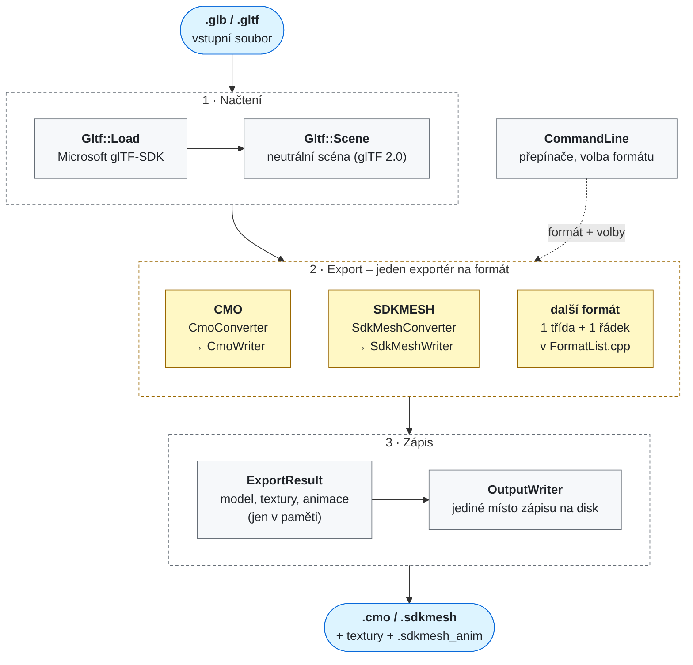

# GlbToMesh

English: [README.en.md](README.en.md)

Konzolová aplikace pro **Windows** (moderní **C++20**, projekt pro **Visual Studio 2026 Community**), která převádí modely
**glTF 2.0** (`.glb` i `.gltf` s vnějšími soubory nebo daty v URI) do formátů Direct3D včetně **materiálů, textur, hierarchie,
kostry, skinningu a animací**. Dnes umí dva výstupní formáty:

| Formát      | Přípona    | Co se zapisuje                                                                                                                                                                                 |
| ----------- | ---------- | ---------------------------------------------------------------------------------------------------------------------------------------------------------------------------------------------- |
| **CMO**     | `.cmo`     | *Visual Studio Compiled Mesh Object* (Starter Kit, DirectXTK – `Model::CreateFromCMO`): meshe se zapečenými světovými maticemi, materiály, textury, kostra, skinning, animace (jsou v souboru) |
| **SDKMESH** | `.sdkmesh` | *DirectX SDK Mesh* verze 101 (Blinn-Phong) nebo 200 (PBR) – DXUT, DirectXTK `Model::CreateFromSDKMESH`: hierarchie snímků, materiály, textury, skinning a animace v souborech `.sdkmesh_anim`  |

Program je postavený tak, aby šel **v budoucnu rozšířit o další výstupní formát** bez zásahu do zbytku programu: nový formát je
jedna třída a jeden řádek v seznamu formátů, viz kapitola [Jak přidat další výstupní formát](#jak-přidat-další-výstupní-formát).

glTF se čte přes **Microsoft glTF-SDK** (`GLBResourceReader`, `GLTFResourceReader`, `Deserialize`); ten je přibalený ve složce
`GlbToMesh\glTF-SDK` (včetně RapidJSON) a sestavuje se jako statická knihovna přímo v řešení. Výstupní soubory zapisují vlastní
zapisovače podle `CMO.h`, `SDKMesh.h` a načítačů z DirectXTK, včetně týchž kontrol limitů, jaké dělají načítače (počty meshů,
materiálů a bufferů, deklarace vrcholů, odkazy mezi snímky), takže program nevytvoří soubor, který by DirectXTK odmítl.

Opačný směr (CMO / SDKMESH → GLB) dělá samostatný program `MeshToGlb`.

## Sestavení (Visual Studio 2026)

Potřebné je jen Visual Studio 2026 Community s úlohou **Vývoj desktopových aplikací v C++** (nástroje MSVC v145,
Windows SDK). Žádné další knihovny ani NuGet balíčky; vše potřebné je ve složce `GlbToMesh\glTF-SDK`.

1. Otevřít `GlbToMesh.slnx`.
2. Zvolit konfiguraci **Debug | x64** nebo **Release | x64** (oba projekty mají konfigurace jen pro x64; platforma x86 je sice uvedena
   v souboru řešení, ale žádný projekt pro ni konfiguraci nemá) a *Sestavit → Sestavit řešení* (`Ctrl+Shift+B`).
3. Výsledek: `GlbToMesh.exe` ve výchozí výstupní složce Visual Studia (např. `x64\Release\` vedle `GlbToMesh.slnx`).

Úklid: `clean.bat` v kořeni smaže složku `.vs` a všechny složky `x64` (výsledky sestavení a mezivýsledky) a na konci čeká na klávesu.

Co řešení obsahuje:

| Projekt     | Typ                                    | Poznámka                                                                                                                                        |
| ----------- | -------------------------------------- | ----------------------------------------------------------------------------------------------------------------------------------------------- |
| `GlbToMesh` | konzolová aplikace (výchozí spouštěný) | `main.cpp`, `CommandLine.*`, `core\`, `formats\`; vstupní bod `wmain` (argumenty a názvy souborů v UTF-16 → UTF-8, takže fungují i české názvy) |
| `glTF-SDK`  | statická knihovna                      | `GlbToMesh\glTF-SDK\Src\*.cpp` (Microsoft glTF-SDK, beze změn); RapidJSON je ve složce `RapidJson`                                              |

Nastavení projektu `GlbToMesh`: `PlatformToolset v145`, `/std:c++20`, režim shody (`/permissive-`), úroveň varování `/W3`. Hlavičky
glTF-SDK se v kódu zapisují jako `<glTF-SDK/Inc/...>` a hledají se od složky projektu (*Další adresáře pro vložené soubory*:
`$(ProjectDir);$(SolutionDir);$(SolutionDir)gltf-SDK`).
Zdrojové soubory jsou UTF-8 s BOM a konci řádků LF, formátování určuje `.clang-format` v kořeni. Standardní knihovna C++ je ponechána
ve výchozím nastavení Visual Studia (dynamické CRT), takže na jiném počítači je potřeba *Microsoft Visual C++ Redistributable*;
chcete-li program bez závislostí, přepněte v *Vlastnosti → C/C++ → Generování kódu → Knihovna runtime* na `/MT`. Argumenty při ladění
se nastavují v *Vlastnosti → Ladění → Argumenty příkazového řádku*.

Z příkazového řádku (*Developer Command Prompt*): `msbuild GlbToMesh.slnx /p:Configuration=Release /p:Platform=x64 /m`.

## Použití

```
GlbToMesh <model.glb|model.gltf> [výstup] [přepínače]
```

Výstupní formát se určí **podle přípony výstupního souboru** (`.cmo`, `.sdkmesh`); přepínač `--format` volbu vynutí. Není-li výstupní
soubor zadán, vezme se název vstupu s příponou formátu, a to jen s `--format` (jinak program neví, kam zapisovat). Vstup se pozná podle
obsahu, ne podle přípony.

Společné přepínače:

| Přepínač                  | Význam                                                                                                                                                                                            |
| ------------------------- | ------------------------------------------------------------------------------------------------------------------------------------------------------------------------------------------------- |
| `-o, --output <soubor>`   | výstupní soubor (výchozí: název vstupu s příponou formátu; vyžaduje `--format`)                                                                                                                   |
| `-f, --format <název>`    | výstupní formát (`CMO`, `SDKMESH`; výchozí: podle přípony výstupního souboru)                                                                                                                     |
| `--list-formats`          | vypíše podporované formáty                                                                                                                                                                        |
| `--no-anim`               | exportovat bez animací (kostra a skinning zůstanou)                                                                                                                                               |
| `--no-textures`           | nezapisovat textury, materiály zůstanou bez nich                                                                                                                                                  |
| `--texture-dir <adresář>` | adresář pro soubory textur (výchozí: adresář výstupního souboru); model odkazuje na textury jen názvem souboru                                                                                    |
| `--left-handed`           | zapsat model v levotočivé soustavě Direct3D → zrcadlit osu Z                                                                                                                                      |
| `--right-handed`          | zapsat model pravotočivě jako glTF → nezrcadlit. Bez obou přepínačů rozhodne formát (u CMO i SDKMESH je výchozí pravotočivá soustava). Vinutí trojúhelníků se vždy zapíše tak, jak ho formát čeká |
| `--srgb-colors`           | barvy materiálů zapsat jako sRGB (glTF je má lineární; pro načítání s `ModelLoader_MaterialColorsSRGB`)                                                                                           |
| `-v, --verbose`           | podrobný výpis                                                                                                                                                                                    |
| `-h, --help`              | nápověda (včetně přepínačů a poznámek jednotlivých formátů)                                                                                                                                       |

Přepínače formátu CMO:

| Přepínač                 | Význam                                                                                                          |
| ------------------------ | --------------------------------------------------------------------------------------------------------------- |
| `--pixel-shader <název>` | název pixel shaderu zapsaný do materiálů (výchozí: žádný, takže `DGSLEffectFactory` použije vestavěný materiál) |

Přepínače formátu SDKMESH:

| Přepínač            | Význam                                                                                                                                                                                                                                           |
| ------------------- | ------------------------------------------------------------------------------------------------------------------------------------------------------------------------------------------------------------------------------------------------ |
| `--anim-fps <n>`    | počet klíčů za sekundu v souborech `.sdkmesh_anim` (výchozí 30, 1 až 1000)                                                                                                                                                                       |
| `--pbr`             | zapsat SDKMESH **verze 200** s PBR materiály (albedo, normála, RMA, emisivní textura; načítá `PBREffectFactory`) místo verze 101 (Blinn-Phong)                                                                                                   |
| `--bake-transforms` | zapéct transformace uzlů statických meshů do vrcholů (světové souřadnice, mesh visí na snímku s jednotkovou maticí) pro prohlížeče, které matice snímků nepoužijí; animované uzly se nezapékají. Viz [Načtení v DirectXTK](#načtení-v-directxtk) |

Přepínač formátu, který nebyl vybrán, je **chybou použití** (kód 2) a hláška říká, kterému formátu patří. Hodnoty přepínačů formátu
se kontrolují ještě před čtením vstupu.

Návratový kód: `0` OK, `1` chyba při čtení nebo převodu, `2` chybné použití (neplatné přepínače).

```
GlbToMesh hero.glb hero.cmo                                 # hero.cmo + textury vedle něj
GlbToMesh hero.glb hero.sdkmesh --pbr                       # verze 200 pro PBREffectFactory
GlbToMesh level.glb level.sdkmesh --bake-transforms         # statické meshe ve světových souřadnicích
GlbToMesh hero.gltf out\hero.sdkmesh --texture-dir out\textury --srgb-colors
GlbToMesh hero.glb --format sdkmesh                         # hero.sdkmesh vedle vstupu
```

Každá animace glTF vznikne u SDKMESH jako jeden soubor vedle modelu: jediná animace se jmenuje `model.sdkmesh_anim` (jak to čeká
DXUT), víc animací `model_<název animace>.sdkmesh_anim`.

### Ukázky převodu

Příklady jsou ze skutečných modelů. `GlbToMesh.exe` se spouští ve složce se vstupním souborem a výstup vzniká vedle něj. Názvy souborů
s mezerou patří do uvozovek. Výpisy jsou zkrácené (vynechané řádky jsou označeny `…`).

**Postava s kostrou a animacemi → CMO.** `hero.glb` má 69 uzlů, 24 meshů, 20 materiálů s texturami, jeden skin a 21 animací:

```
GlbToMesh.exe hero.glb --format CMO --left-handed
```

```
Reading hero.glb
  glTF: 69 nodes, 24 meshes (38 primitives), 20 materials, 20 images, 1 skins, 21 animations
Warning: 4 animation channels were not exported: CMO animates only the bones of skinned meshes (no animation of plain nodes or morph target weights).
Warning: 5 primitives have morph targets, which CMO does not support - only the base shape is exported.
Written hero.cmo (2591146 bytes): 24 meshes (1 skinned), 38 submeshes, 6380 vertices, 2879 triangles, 38 materials, 20 textures, 43 bones, 17 animation clips (28956 keys)
2 warning(s) - see above.
```

Vznikne `hero.cmo` a vedle něj 20 souborů PNG s texturami (klipy animací jsou uvnitř `.cmo`). Výstupní soubor není zadán, proto je
nutné `--format`; název výstupu se vezme ze vstupu. `--left-handed` použijte, pokud aplikace počítá v levotočivé soustavě
(`XMMatrixLookAtLH` apod.). Obě varování jsou jen upozornění (návratový kód je 0): CMO neumí animovat obyčejné uzly, jen kosti
skinovaných meshů, ani morph targets.

**Totéž do SDKMESH, se zapečenými transformacemi:**

```
GlbToMesh.exe hero.glb --format SDKMESH --left-handed --bake-transforms
```

```
Reading hero.glb
  glTF: 69 nodes, 24 meshes (38 primitives), 20 materials, 20 images, 1 skins, 21 animations
Warning: Some materials are double-sided; SDKMESH has no such flag, so DirectXTK draws them single-sided (draw the model with culling disabled if needed).
Warning: 4 animation channels were not exported (nodes outside of the exported scene, morph target weights or duplicate channels).
Warning: 5 primitives have morph targets, which SDKMESH does not support - only the base shape is exported.
Written ./hero_chuze-pom01.sdkmesh_anim (80536 bytes): animation 'chuze-pom01', 43 tracks, 44 keys at 30 per second
…
Written ./hero_zas-tel01.sdkmesh_anim (106336 bytes): animation 'zas-tel01', 43 tracks, 59 keys at 30 per second
Written hero.sdkmesh (317496 bytes, SDKMESH 101): 94 frames, 24 meshes (1 skinned), 24 vertex buffers, 38 subsets, 6380 vertices, 2879 triangles, 21 materials, 20 textures, 17 animations (62006 keys), 23 baked into world coordinates
3 warning(s) - see above.
```

Každá ze 17 animací je samostatný soubor `hero_<název animace>.sdkmesh_anim`. Souhrn na konci říká, že **23 z 24 meshů** (všechny
neskinované) se zapeklo do světových souřadnic; skinovaný mesh zůstal beze změny. Model tak stojí na správném místě i v prohlížeči,
který matice snímků nepoužívá (viz [Načtení v DirectXTK](#načtení-v-directxtk)). Varování o oboustranných materiálech znamená, že SDKMESH
nemá příznak `doubleSided`; chcete-li je vidět z obou stran, musí aplikace vypnout odřezávání odvrácených stran.

**Model s mezerou v názvu a jednou animací → SDKMESH.** `Crouch Walk Forward.glb` (postava *Maria* z Mixamo) má dva skinované meshe,
jediný materiál a animaci `mixamo.com`:

```
GlbToMesh.exe "Crouch Walk Forward.glb" --format SDKMESH --left-handed
```

```
Reading Crouch Walk Forward.glb
  glTF: 68 nodes, 2 meshes (2 primitives), 1 materials, 2 images, 1 skins, 1 animations
Warning: Some materials are double-sided; SDKMESH has no such flag, so DirectXTK draws them single-sided (draw the model with culling disabled if needed).
Written ./Crouch Walk Forward.sdkmesh_anim (106120 bytes): animation 'mixamo.com', 65 tracks, 38 keys at 30 per second
Written Crouch Walk Forward.sdkmesh (719968 bytes, SDKMESH 101): 71 frames, 2 meshes (2 skinned), 2 vertex buffers, 2 subsets, 9626 vertices, 14646 triangles, 1 materials, 2 textures, 1 animations (2470 keys)
1 warning(s) - see above.
```

Jediná animace se jmenuje jako model (`Crouch Walk Forward.sdkmesh_anim`, jak to čeká DXUT), i když se v glTF jmenuje `mixamo.com`.
Vedle modelu vzniknou textury `maria_diffuse.png` a `maria_normal.png`. U tohoto modelu se po načtení může objevit problém se zeleným
kanálem normálové mapy, viz [Normálové mapy a zelený kanál G](#normálové-mapy-a-zelený-kanál-g).

**Další varianty:**

```
GlbToMesh.exe "Crouch Walk Forward.glb" "Crouch Walk Forward.cmo"                                    # formát podle přípony
GlbToMesh.exe "Crouch Walk Forward.glb" out\Maria.sdkmesh --texture-dir out\textury --no-anim        # textury do jiné složky, bez animací
GlbToMesh.exe --list-formats                                                                         # vypíše CMO a SDKMESH
```

Druhý příkaz zapíše `out\Maria.sdkmesh` a textury do `out\textury`. Model odkazuje na textury jen názvem souboru, proto aplikace
musí použít `fx.SetDirectory(L"out\\textury")`.

**Chybné použití** končí kódem 2 a hláška říká, co je špatně (přepínač patří jinému formátu; formát nelze poznat):

```
GlbToMesh.exe "Crouch Walk Forward.glb" --format CMO --bake-transforms
Error: The option --bake-transforms is not supported by the format CMO (it belongs to SDKMESH)

GlbToMesh.exe "Crouch Walk Forward.glb"
Error: Cannot tell the output format: give the output file with a known extension or use --format (supported formats: CMO, SDKMESH)
```

### Načtení v DirectXTK

Oba formáty obsahují jen názvy souborů textur; textury se zapisují vedle modelu (nebo do `--texture-dir`) a továrna efektů je hledá
v adresáři nastaveném přes `SetDirectory`.

**CMO:**

```cpp
DGSLEffectFactory fx(device);
fx.SetDirectory(L"assets");
auto model = Model::CreateFromCMO(device, L"assets\\hero.cmo", fx);   // výchozí ModelLoader_CounterClockwise
```

Vinutí trojúhelníků je po směru hodin (jako zapisuje Visual Studio), s výchozími příznaky `CreateFromCMO` tedy správně. Pro model
z `--srgb-colors` přidej `ModelLoader_MaterialColorsSRGB`; pro model s kostrou `ModelLoader_IncludeBones` (bez něj se kostra nenačte).
Klipy leží v souboru za daty meshů (posun vrací parametr `animsOffset`); DirectXTK je sám nepřehrává, to dělá kód aplikace
(např. Starter Kit). Pokud aplikace používá levotočivé matice (`XMMatrixLookAtLH` apod.), vyrob model s `--left-handed`.

**SDKMESH:**

```cpp
EffectFactory fx(device);
fx.SetDirectory(L"assets");
auto model = Model::CreateFromSDKMESH(device, L"assets\\hero.sdkmesh", fx,
                                      ModelLoader_CounterClockwise | ModelLoader_IncludeBones);
```

- Trojúhelníky jsou zapsané **po směru hodin při pohledu zvenku** (jako v souborech z DXUT a v `tank.sdkmesh`), proto se načítá
  s `ModelLoader_CounterClockwise` (odříznutí odvrácených stran). To platí i pro `--left-handed`, pokud aplikace používá levotočivé
  matice (`XMMatrixLookAtLH` apod.). Výchozí `ModelLoader_Clockwise` je určeno pro soubory z DXUT nakreslené v pravotočivé aplikaci,
  jako je `soldier.sdkmesh`.
- `ModelLoader_IncludeBones` je potřeba pro načtení hierarchie snímků (`Model::bones`) a kostry pro skinning. Pro model z
  `--srgb-colors` přidej `ModelLoader_MaterialColorsSRGB`.
- Soubor verze 200 (`--pbr`) načítá `PBREffectFactory` místo `EffectFactory`.
- **Prohlížeč, který matice snímků nepoužije.** DirectXTK použije matice snímků (transformace uzlů) jen při kreslení s maticemi kostí:
  `ModelLoader_IncludeBones`, `Model::CopyAbsoluteBoneTransformsTo` a `Model::Draw` s polem matic kostí. Prohlížeč, který model kreslí
  bez nich (některé to hlásí jako „Ignoring model bones“), vykreslí každý mesh v jeho místních souřadnicích. Skinované meshe tím
  netrpí, protože se zapisují ve světových souřadnicích, ale **statické meshe s transformací uzlu** se objeví na špatném místě. Typicky
  jde o objekty přesunuté v Blenderu (*Selection to Cursor* posouvá objekt, ne jeho vrcholy). Takový model převeďte s
  `--bake-transforms`; s prohlížečem, který matice snímků používá, vypadá stejně jako bez něj.
- Animaci načte a přehraje kód aplikace – viz lekce DirectXTK
  [Animating using model bones](https://github.com/microsoft/DirectXTK/wiki/Animating-using-model-bones) a
  [Using skinned models](https://github.com/microsoft/DirectXTK/wiki/Using-skinned-models) (třída `DX::AnimationSDKMESH`:
  `Load(L"hero.sdkmesh_anim")`, `Bind(*model)`, `Update(dt)`). Animace se přiřazují ke snímkům podle jejich **názvů**, proto se
  názvy v modelu nemění.

## Normálové mapy a zelený kanál G

Častý vizuální problém po převodu: **reliéf textury je osvětlený naruby**. Typickým příkladem je `Crouch Walk Forward.glb` (postava
*Maria* z Mixamo, jediný materiál `MariaMat`, textury `maria_diffuse.png` a `maria_normal.png`).

**Příznak.** Po načtení výsledného `.sdkmesh` nebo `.cmo` v aplikaci s Direct3D je povrch špatně osvětlený: záhyby, výzdoba brnění,
štít a meč vypadají vtlačené místo vypouklých a na površích jsou nápadně tmavé plochy. Difuzní textura je v pořádku, vadí normálová.

**Příčina.** Normálová mapa ukládá směr normály do barev: R = osa X, G = osa Y, B = osa Z (proto je mapa převážně modrofialová).
Svislou složku nese kanál **G**, ten „zelený“, a ten mají dvě konvence opačně: glTF předepisuje osu Y nahoru (konvence „OpenGL“, Y+),
kdežto mapy a shadery pro Direct3D často čekají Y− (mapy „DirectX“). Čte-li se mapa jedné konvence shaderem druhé, obrátí se svislá
složka normály a světlo dopadá na reliéf z opačné strany; kanály R a B se nemění. Program textury **zapisuje beze změny**, protože neví,
jak s nimi naloží shader vaší aplikace; přepínač pro převrácení kanálu G zatím nemá.

Že jde o tuto příčinu, vyplývá z konvencí a ze snímků modelu v prohlížeči Direct3D; samotné načtení v DirectXTK jsem nezkoušel.
Ověřit to můžete tím, že kanál G převrátíte (níže): jestliže se stínování opraví, šlo o tento problém. Mapa v konvenci OpenGL vypadá,
jako by byla ve svém zeleném kanálu osvětlená shora: horní hrany vypouklých detailů jsou světlejší než spodní.

**Řešení 1 (doporučené): převrátit kanál G textury.** Program zapíše `maria_normal.png` vedle modelu (nebo do `--texture-dir`)
a model na něj odkazuje jen názvem souboru, takže stačí soubor nahradit opravenou kopií **pod stejným názvem**. Originál zůstává v GLB.

**a) `texconv.exe` (DirectXTex od Microsoftu).** Nástroj příkazového řádku, který kanál G převrátí jednou volbou. Název programu je
`texconv` (bez „t“ navíc). Instalace: `winget install Microsoft.DirectXTex.Texconv`, nebo ruční stažení `texconv.exe` z vydání DirectXTex
na GitHubu. Příkazy se spouštějí ve složce s modelem a texturou:

```
mkdir _fix
texconv --invert-y --ignore-srgb -ft png -nologo -o _fix maria_normal.png
move /y _fix\maria_normal.png maria_normal.png
rmdir _fix
```

- `--invert-y` převrátí kanál G. Aktuální dokumentace texconv uvádí `--invert-y`; ve starších verzích se píše `-inverty`.
- `-ft png` je nutné: výchozí typ výstupu je DDS, takže bez něj vznikne `maria_normal.dds`, na který model neodkazuje.
- `-o _fix` zapíše výsledek do jiné složky. Texconv totiž ve výchozím nastavení existující soubor nepřepíše (přepsání zapíná `-y`)
  a název výstupu je název vstupu s novou příponou, takže `move` jen nahradí původní soubor.
- `--ignore-srgb` zruší údaje o barevném prostoru v PNG: normálová mapa jsou data, ne barva, a nemá se brát jako sRGB.
- Všechny normálové mapy najednou: `texconv --invert-y --ignore-srgb -ft png -nologo -o _fix *_normal.png` (texconv bere zástupné
  znaky `*` a `?`; upravte masku podle názvů svých textur).

`texconv` je program pro Windows a v prostředí, kde vznikl tento popis, jsem ho nespouštěl; příkazy vycházejí z jeho dokumentace.
Výsledek proto zkontrolujte skriptem v části **Kontrola výsledku** níže.

**b) ImageMagick** (nic dalšího není potřeba):

```
:: ImageMagick 7 (u verze 6 místo magick použijte convert)
magick maria_normal.png -channel G -negate +channel maria_normal_fixed.png
```

**c) Python s balíčkem Pillow:**

```python
# Python s balíčkem Pillow (pro PNG typu RGB nebo RGBA)
from PIL import Image, ImageChops

img = Image.open("maria_normal.png")
channels = list(img.split())                        # R, G, B (případně A)
channels[1] = ImageChops.invert(channels[1])        # G → 255 - G
Image.merge(img.mode, channels).save("maria_normal_fixed.png")
```

Postup přes Pillow a ImageMagick 6 jsem na textuře `maria_normal.png` vyzkoušel: kanály R a B zůstanou beze změny a G se změní na
`255 − G`.

**d) Editor obrázků** (Photoshop, GIMP, Krita): vyberte jen kanál G a invertujte ho.

Výsledek z variant b) až d) (`maria_normal_fixed.png`) potom přejmenujte na `maria_normal.png`, čímž nahradí původní soubor vedle modelu.

**Kontrola výsledku.** Před nahrazením si originál uložte (např. jako `maria_normal_orig.png`) a skriptem ověřte, že se změnil jen
kanál G (stačí Pillow):

```python
# check_flip.py – použití: python check_flip.py maria_normal_orig.png maria_normal.png
import sys
from PIL import Image, ImageChops

orig = Image.open(sys.argv[1]).convert("RGB")
fixed = Image.open(sys.argv[2]).convert("RGB")
if orig.size != fixed.size:
    sys.exit("Různé rozměry: %s a %s" % (orig.size, fixed.size))

r1, g1, b1 = orig.split()
r2, g2, b2 = fixed.split()
r_ok = ImageChops.difference(r1, r2).getbbox() is None
b_ok = ImageChops.difference(b1, b2).getbbox() is None
g_ok = ImageChops.difference(ImageChops.invert(g1), g2).getbbox() is None
print("R beze změny:", r_ok, "| B beze změny:", b_ok, "| G = 255 - G:", g_ok)
sys.exit(0 if (r_ok and b_ok and g_ok) else 1)
```

Výpis `R beze změny: True | B beze změny: True | G = 255 - G: True` a návratový kód 0 znamenají, že se převrátil právě kanál G. Skript
jsem vyzkoušel na výsledcích z Pillow a ImageMagick 6 (projdou) a na nezměněném souboru i na souboru s invertovanými všemi kanály
(neprojdou); na výstupu `texconv` jsem ho nezkoušel.

**Řešení 2: opravit shader nebo prohlížeč.** Po rozbalení normály z textury (`n = tex.rgb * 2 - 1`) obraťte znaménko `n.y = -n.y`.
U `NormalMapEffect` z DirectXTK je jednodušší opravit texturu, protože jeho shader není součástí vaší aplikace.

Pozor:

- Opravte **jen na jednom místě**: obrátíte-li kanál G v textuře i v shaderu, oprava se vzájemně ruší.
- **Každý další převod modelu zapíše `maria_normal.png` znovu a přepíše tak opravený soubor** (vyzkoušeno). Opravu proto spouštějte
  až po posledním převodu, nejlépe skriptem nebo dávkou, která převod a opravu spojí.

**Co u tohoto modelu navíc chybí.** Materiál `MariaMat` používá rozšíření `KHR_materials_specular` s texturou odlesku
(v GLB se jmenuje `maria_specular`). Program ho nečte, texturu nezapisuje a nevypisuje k tomu varování.

## Architektura

Cesta dat programem: soubor glTF → načtení do neutrální scény → exportér vybraného formátu → obsah souborů v paměti → zápis na disk.



Důležité je rozdělení odpovědností:

- **Načtení** (`core\GltfLoader.*`) převede dokument glTF na neutrální scénu `Gltf::Scene` (`core\GltfScene.h`): materiály, meshe
  rozložené na trojúhelníky, uzly, skiny a animace. O cílovém formátu nic neví, jen mu předá jeho název pro hlášení o rozšířeních,
  která formát nedokáže vyjádřit.
- **Exportér formátu** (`GlbToMesh\formats\<formát>\`) převede scénu na obsah souborů svého formátu a vrátí ho **v paměti** jako
  `Formats::ExportResult`. Zodpovídá za *všechno*, co je specifické pro formát: zrcadlení osy Z, vinutí trojúhelníků, rozložení
  vrcholů, materiály, kostru, animace, limity formátu. Na disk nezapisuje.
- **Společný základ** `ExportUtil::SceneConverter` (`core\ExportUtil.*`) nabízí exportérům to, co potřebují všechny: světové matice
  uzlů, zrcadlení osy Z, vzorkování animačních kanálů, doplnění normál a tangent, vytažení textur z glTF s jedinečnými bezpečnými
  názvy souborů a varování, která se vypíšou jen jednou.
- **Zápis** (`core\OutputWriter.*`) je jediný a pořadí je pevné: model, textury, doprovodné soubory, závěrečný výpis. Chyba exportéru
  tak nikdy nezanechá napůl zapsané soubory.
- **Registr formátů** (`core\FormatRegistry.cpp`) formáty vyhledává podle názvu a přípony, hlídá kolize názvů, přípon a přepínačů
  a poskytuje je příkazové řádce a nápovědě. Příkazová řádka (`CommandLine.cpp`) o konkrétních formátech nic neví: nápovědu,
  kontrolu přepínačů formátu i vlastnictví přepínačů čte z toho, co formát o sobě sdělí.

Struktura zdrojových kódů:

```
.clang-format                  pravidla formátování
GlbToMesh.slnx                 řešení
README.md, README.en.md
clean.bat                      smaže .vs a všechny složky x64
data/                          ukázkové modely, textury a výstupy (do sestavení nepatří)
GlbToMesh/
  GlbToMesh.vcxproj(.filters)  projekt aplikace
  main.cpp                     vstupní bod: registrace formátů, přepínače, načtení, export, zápis
  CommandLine.h/.cpp           přepínače, nápověda, volba formátu, kontrola přepínačů formátů
  core/
    OutputFormat.h             rozhraní formátu, přepínače formátu, výsledek exportu, registr
    FormatRegistry.cpp         registr formátů
    OutputWriter.h/.cpp        jediný zápis souborů na disk
    GltfLoader.h/.cpp          načtení glTF/GLB (Microsoft glTF-SDK) do Gltf::Scene
    GltfScene.h                neutrální model scény
    ExportUtil.h/.cpp          společný základ převodníků (SceneConverter)
    FileUtil, TextUtil, MathUtil, Log
  formats/
    FormatList.cpp             SEZNAM FORMÁTŮ (jediné místo, které se při přidání formátu upravuje)
    cmo/                       CmoOutputFormat (adaptér), CmoConverter (převod), CmoWriter (zápis), CmoModel.h, CmoFormat.h (struktury souboru)
    sdkmesh/                   SdkMeshOutputFormat, SdkMeshConverter, SdkMeshWriter, SdkMeshModel.h, SdkMeshFormat.h
  glTF-SDK/                    Microsoft glTF-SDK + RapidJSON (statická knihovna, beze změn)
```

### Konvence ve zdrojových kódech

- **Záhlaví souboru** má šablonu s `@file`, `@brief` a verzí; podrobnější popis souboru (pravidla převodu, rozložení formátu) je
  pod řádkem `@copyright`.
- **Komentáře** jsou česky ve stylu Doxygen. Jednoduché metody a typy mají jednořádkový `///`, ostatní blok `/** … */` s
  `@param <typ> <název> popis`, `@return <typ> popis` a `@throws`. Metody tříd, které jsou celé v `.cpp` (převodníky `Converter`,
  zapisovače), jsou popsané u deklarace uvnitř třídy. Jednotlivá pole struktur se nekomentují jedna po druhé, jen kde to není z názvu
  zřejmé.
- **Členy tříd** se jmenují bez předpony (`model`, `scene`, `mirror`) a uvnitř třídy se vždy používají s `this->`. Předpona `m_`
  se nepoužívá. Přibalený Microsoft glTF-SDK `m_` používá, ale je to cizí kód, který se kvůli snadnému porovnání s originálem
  nemění.
- **Soubory**: UTF-8 s BOM, konce řádků LF (`.vcxproj` a `.slnx` mají CRLF), odsazení tabulátory.

## Co se převádí a jak

### Společné pro oba formáty

**Vstup.** Převádí se scéna vybraná v souboru (jinak první). Podporované jsou primitiva trojúhelníky, pruhy i vějíře (zdegenerované
trojúhelníky se vypouštějí), indexovaná i neindexovaná, atributy `float` i normalizované celočíselné (`KHR_mesh_quantization`),
prokládané buffery a **řídké (sparse) akcesory**; `.gltf` s vnějšími soubory i s daty URI.
- Chybí-li `NORMAL`, glTF předepisuje **plošné stínování**: vrcholy se rozdělí a každý trojúhelník dostane svou normálu.
- `TANGENT` se použije, jinak se tečna dopočítá z UV (V v glTF roste dolů, UV se nepřevrací).
- `COLOR_0` (vec3/vec4, float i normalizované celé) → barva vrcholu. Druhá sada UV a další atributy se neexportují; jiná sada UV než
  `TEXCOORD_0` se u textury nepodporuje (varování).
- Vrchol má nejvýš **4 vlivy** kostí: ze `JOINTS_0/1` se vyberou čtyři nejsilnější a váhy se znovu normalizují (počet takových vrcholů
  se vypíše). Skinovaný mesh se zapisuje v klidové poloze beze změny (transformace uzlu skinovaného meshe se podle specifikace glTF
  ignoruje). Nad 72 kostí je varování (limit skinovaných efektů DirectXTK).

**Souřadnice a vinutí.** glTF je **pravotočivé**, stejně jako CMO z Visual Studia (ověřeno na skutečném `teapot.cmo`) a DirectXTK,
proto se ve výchozím stavu pozice, normály a matice kopírují beze změny. glTF má přední strany proti směru hodin, oba formáty po
směru hodin (výchozí stav rasterizéru Direct3D), proto se u každého trojúhelníku prohodí druhý a třetí index – kromě trojúhelníků
pod uzlem, jehož matice obrací orientaci (záporné měřítko, `det < 0`): ty už po transformaci po směru hodin jsou.
`--left-handed` zrcadlí osu Z (pozice, normály a tangenty `z → -z`, znaménko tangenty se obrací, matice jako `S·M·S` pro
`S = diag(1,1,-1)`, totéž u klíčů animací a inverzních bind matic; kvaterniony klíčů `(x,y,z,w) → (-x,-y,z,w)`, posuny `z → -z`);
vinutí zůstává po směru hodin také na obrazovce. Matice v obou formátech jsou řádkové (`v' = v·M`) a mají stejné paměťové rozložení
jako sloupcové matice glTF, proto se netransponují.

**Materiály a textury.**
- `baseColorFactor` → difuzní barva (ambient = 0,2 × diffuse; alfa se přenáší jen při `alphaMode: BLEND`; `MASK` formáty nezná –
  exportuje se jako neprůhledný s varováním), `emissiveFactor` × `KHR_materials_emissive_strength` → emisivní barva.
- Lesk: z `roughness` se spočítá exponent odlesku (Blinn-Phong, `roughness = √(2/(n+2))`), barva odlesku ze základní odrazivosti
  (0,04 pro dielektrika, barva materiálu pro kovy); drsné (≥ 0,95) a `KHR_materials_unlit` materiály jsou bez odlesku.
  `KHR_materials_pbrSpecularGlossiness` se převede přímo (`specularFactor`, `glossinessFactor`).
- Obrázky se **zapíšou tak, jak jsou** (PNG, JPEG, …; DirectXTK je načítá přes WIC, `.dds` také); název souboru je z názvu obrázku
  v glTF (bezpečný název bez cest a zakázaných znaků, jedinečný), jinak z názvu modelu. WebP a KTX2 se také zapíšou, ale DirectXTK je
  nenačte (upozornění). Obrázek, který nelze přečíst (chybějící soubor, absolutní nebo nebezpečná cesta, adresa `http`), se přeskočí
  s upozorněním a materiál zůstane bez textury.
- Normálové mapy se kopírují beze změny. glTF používá konvenci kanálu G jako OpenGL; chce-li ji aplikace v Direct3D opačně, musí se
  textura v editoru převrátit. Příznakem opačné konvence bývá reliéf osvětlený naruby nebo nápadně tmavý povrch. Podrobně včetně
  postupu opravy viz [Normálové mapy a zelený kanál G](#normálové-mapy-a-zelený-kanál-g).

### CMO

CMO nemá hierarchii uzlů, takže se do vrcholů zapéká **světová matice uzlu** (pozice maticí, normály inverzní transpozicí, tangenty
maticí); každý uzel s meshem vznikne jako jeden mesh CMO (název uzlu, jinak meshe, jinak `Mesh_N`; shodné názvy dostanou příponu
`_2`, `_3`…). Mesh použitý ve více uzlech se zapíše pro každý uzel zvlášť. Primitiva → podsítě (`submesh`) podle materiálu. CMO má
**16bitové indexy**: primitivum s více než 65 535 vrcholy se rozdělí na víc vertex bufferů (podsítí) po sobě jdoucích trojúhelníků;
vrchol na hranici se zduplikuje. Obálka (střed, poloměr, min, max) se počítá z výsledných vrcholů.

- **Textury:** `baseColorTexture` → slot 0 (difuzní), `normalTexture` → slot 2, `emissiveTexture` → slot 3. Textury
  `metallicRoughness`, `occlusion` a `specularGlossiness` nemají v CMO obdobu a vynechávají se (s varováním).
  `KHR_texture_transform` → `uvTransform` materiálu (CMO má jednu matici na materiál: použije se z první textury, která ji má;
  liší-li se, je varování).
- **Kostra a skinning.** Kostra vznikne z kloubů skinu; uzly mezi klouby (a nad kořenem skeletu, např. uzel *Armature*) se **složí do
  lokální matice kosti**, takže světové matice kostí odpovídají glTF. Kosti se řadí tak, aby rodič byl před potomkem (první je
  kořen; kořenů smí být víc, DirectXTK je řadí jako sourozence), pořadí kloubů ve skinu může být libovolné. Inverzní bind matice se
  berou ze skinu. Kosti bez názvu uzlu se jmenují `Bone_N`. Víc skinů ve scéně: každý mesh nese kostru svého skinu, ale DirectXTK
  použije kostru jen jednoho (varování).
- **Animace.** Každá animace glTF, která se týká uzlů kostí některého skinu, → jeden klip CMO (název animace, jinak `Clip_N`) s klíči
  `kost + čas + plná lokální matice`. Klíče vznikají vyhodnocením kanálů (translation / rotation / scale; LINEAR se slerpem, STEP,
  CUBICSPLINE s Hermiteovou interpolací) v časech všech klíčů kanálů, které kost ovlivňují. STEP se doplní klíčem těsně před dalším
  skokem, CUBICSPLINE se vzorkuje (4 mezikroky v každém úseku). Neanimovaná kost dostane klíče na začátku a konci klipu. Čas klipu
  začíná nulou. Klipy se zapisují k prvnímu meshi každého skinu.

### SDKMESH

Na rozdíl od CMO má SDKMESH **hierarchii snímků** (*frames*), takže se transformace uzlů ve výchozím stavu **nezapékají**
(zapéct je lze volbou `--bake-transforms`, viz níže): každý uzel scény je snímek
s lokální maticí, snímek 0 je nepojmenovaný jednotkový kořen a snímky následují v pořadí průchodu do hloubky. Názvy snímků, meshů,
podmnožin a materiálů jsou nejvýš 99 bajtů UTF-8 a jedinečné (shodné dostanou příponu `_2`, `_3`…). DirectXTK váže mesh jen k prvnímu
snímku, který na něj odkazuje, takže **každá instance** (uzel s meshem) má vlastní záznam meshe; vertex a index buffery se sdílejí.
Instance pod uzlem se zápornou determinantou dostane vlastní geometrii s původním pořadím indexů.

- **Geometrie.** Primitiva jednoho meshe se spojí do jednoho vertex a index bufferu, každé primitivum je podmnožina (*subset*)
  s materiálem. Rozložení vrcholu (jako v souborech DXUT, deklarace D3D9): `POSITION` (float3), u skinovaných `BLENDWEIGHT` +
  `BLENDINDICES` (4× ubyte), `NORMAL`, volitelně `COLOR` (`D3DCOLOR`), `TEXCOORD0`, volitelně `TANGENT` + `BINORMAL` (jen u meshů, jejichž
  materiál má normálovou texturu). Barva vrcholu se zapíše jen tehdy, má-li ji aspoň jedno primitivum meshe. **Skinované meshe mají
  vždy `TEXCOORD0`** (i bez textur) – skinované efekty DirectXTK ho vyžadují. Indexy jsou 16bitové, nad 65 536 vrcholů 32bitové.
  Střed a rozměr obálky meshe se počítají z výsledných vrcholů.
- **Materiály verze 101 (výchozí).** Textury: `baseColorTexture` → difuzní, `normalTexture` → normálová. Emisivní,
  `metallicRoughness`, `occlusion` a `specularGlossiness` textury nemají ve verzi 101 obdobu a vynechávají se (s varováním).
  Normálová mapa bez difuzní textury se v `NormalMapEffect` zobrazí černě (varování). DirectXTK sdílí efekty podle **názvu
  materiálu**, a podle příznaků deklarace vrcholů (skinning, barvy vrcholů) se efekt vytváří pro první vertex buffer, který materiál
  používá. Proto má každá kombinace materiálu a příznaků vlastní záznam s jedinečným názvem (`Kov`, `Kov_skinned`, `Kov_vcolor`…).
  `KHR_texture_transform` se **zapeče do souřadnic UV** vrcholů (SDKMESH nemá matici UV; použije se z první textury, která ji má;
  liší-li se, je varování).
- **Materiály verze 200 (`--pbr`).** Albedo ← `baseColorTexture`, normála ← `normalTexture`, **RMA** ← `metallicRoughnessTexture`
  (kanály zůstávají v uspořádání glTF: R = okluze, G = drsnost, B = kovovost, což je přesně to, co čeká `PBREffect`), emisivní ←
  `emissiveTexture`, `Alpha` ← alfa základní barvy při `BLEND`. Verze 200 nemá žádné faktory materiálu, takže `PBREffectFactory`
  potřebuje všechny tři hlavní textury (albedo, normála, RMA); chybí-li některá, je varování.
- **Kostra a skinning.** Kostra je tvořena snímky kloubů. Váhy se zapisují jako `UBYTE4N` se součtem přesně 255. Skinované vrcholy se
  zapisují v **klidové poloze ve světových souřadnicích**: do vrcholu se vloží matice `Σ w · (světová matice kloubu · inverzní bind
  matice)` (u správně připravených modelů je jednotná a odpovídá světové transformaci kostry), protože DirectXTK i DXUT si inverzní
  bind matice dopočítají z klidové pózy snímků. Mesh visí na samostatném snímku `<název>_Mesh` s jednotkovou maticí. Seznam vlivů
  meshe obsahuje jen použité klouby (nejvýš 256; nad **72** kostí je varování – limit skinovaných efektů DirectXTK, `DrawSkinned`
  jinak vyhodí výjimku). Klouby mimo vybranou scénu (a jejich předci) se přidají jako snímky navíc.
- **Zapékání transformací (`--bake-transforms`).** Neskinované meshe, jejichž uzel ani žádný předek nemá animační kanál, dostanou
  vrcholy ve **světových souřadnicích**: pozice, tangenty a binormály se vynásobí světovou maticí uzlu, normály její inverzní
  transpozicí, potom se případně zrcadlí osa Z. Mesh visí na samostatném snímku `<název uzlu>_Mesh` s jednotkovou maticí pod kořenem,
  tedy stejně jako skinované meshe, takže ho vykreslí na správném místě i prohlížeč, který matice snímků nepoužije. Snímky uzlů
  zůstávají a mají své matice (animace je mění), jen na nich mesh nevisí. Instance pod uzlem se zápornou determinantou mají indexy
  v původním pořadí, stejně jako bez této volby. Geometrie se kvůli tomu nesdílí mezi instancemi. Meshe pod **animovanými** uzly se
  nezapékají (při přehrávání by se nehýbaly): zůstanou na snímcích uzlů a program to ohlásí varováním; chcete-li zapéct i je, převeďte
  model s `--no-anim`. Skinované meshe volba nemění. Souhrn na konci výpisu uvádí počet zapečených meshů.
- **Animace.** Každá animace glTF, která se týká uzlů exportovaných snímků, → jeden soubor `.sdkmesh_anim` (SDKANIMATION) s jednou
  stopou na animovaný snímek (podle jeho názvu) a klíči `posun + kvaternion + měřítko` v **pevných časech** `k / FPS` od začátku
  animace (DXUT přehrává klíče 1 … N-1, proto jsou potřeba nejméně dva). Klíče vznikají vyhodnocením kanálů (LINEAR se slerpem, STEP,
  CUBICSPLINE s Hermiteovou interpolací); STEP se tedy vzorkuje v pevných časech a skok se může posunout nejvýš o 1/FPS. Kvaterniony
  jsou spojité (žádné skoky znaménka). Zapisuje se i měřítko, ale **DXUT ho při přehrávání ignoruje**. Animace, která neanimuje žádný
  exportovaný uzel, se vynechá.

## Jak přidat další výstupní formát

Příklad: formát **Wavefront OBJ** (`.obj`). Postup má pět kroků a nemění příkazovou řádku, nápovědu, zápis souborů ani načtení
glTF. Ukázka níže je celý zdrojový soubor minimálního exportéru (zapíše geometrii všech uzlů s meshi do textového OBJ). Jako vzor
ve skutečné velikosti slouží `formats\cmo\CmoOutputFormat.cpp` a `formats\sdkmesh\SdkMeshOutputFormat.cpp`.

**1. Přidat složku `GlbToMesh\formats\obj\`** s hlavičkou a zdrojem exportéru. Hlavička je vždy stejná:

```cpp
#pragma once

// Hlavičkové soubory C++
#include <memory>

// Hlavičkové soubory projektu
#include "core/OutputFormat.h"

namespace Obj {

    /// Vytvoří formát OBJ pro registraci v FormatRegistry
    std::unique_ptr<Formats::OutputFormat> CreateOutputFormat();
}
```

**2. Napsat třídu odvozenou od `Formats::OutputFormat`** a funkci `CreateOutputFormat` (zdrojový soubor
`formats\obj\ObjOutputFormat.cpp`). Povinné jsou `Name`, `Description`, `Extensions` a `Export`; `Options` (vlastní přepínače),
`HelpNotes` (odstavec nápovědy) a `ValidateOptions` (kontrola přepínačů před čtením vstupu) jsou nepovinné. Ukázka vyrobí text
OBJ ze všech uzlů s meshi a má jeden vlastní přepínač `--obj-precision`:

```cpp
/**
 * @file      ObjOutputFormat.cpp
 * @author    Lubomír Tomandl (info@web-data.cz)
 * @brief     Ukázkový výstupní formát Wavefront OBJ: pozice a trojúhelníky všech uzlů s meshi
 * @version   1.0
 *
 * @copyright (c) Lubomír Tomandl - Angry Developer Studio
 *
 * Nejmenší užitečný exportér: ukazuje všechny části rozhraní Formats::OutputFormat (název, přípony, vlastní přepínač, kontrolu
 * přepínačů, export) a použití společného základu ExportUtil::SceneConverter (světové matice uzlů, zrcadlení osy Z).
 */

// Hlavičkové soubory C++
#include <exception>
#include <iomanip>
#include <sstream>
#include <stdexcept>
#include <string>
#include <vector>

// Hlavičkové soubory projektu
#include "ObjOutputFormat.h"

#include "core/ExportUtil.h"
#include "core/MathUtil.h"

namespace Obj {

    namespace {

        /// Výchozí počet desetinných míst souřadnic
        constexpr int DEFAULT_PRECISION = 6;

        /**
         * Přečte hodnotu přepínače --obj-precision.
         *
         * @param const Formats::OptionSet& options Přepínače tohoto formátu
         *
         * @return int Počet desetinných míst
         *
         * @throws Formats::UsageError Pokud hodnota není číslo od 0 do 9
         */
        int ParsePrecision(const Formats::OptionSet &options)
        {
            if (!options.Has("obj-precision")) {
                return DEFAULT_PRECISION;
            }

            const std::string text = options.Last("obj-precision");
            size_t used = 0;
            int value = 0;

            try {
                value = std::stoi(text, &used);
            }
            catch (const std::exception &) {
                used = 0;
            }

            if (used != text.size() || value < 0 || value > 9) {
                throw Formats::UsageError("--obj-precision must be a number from 0 to 9");
            }

            return value;
        }

        /// Převodník scény na text OBJ; ze společného základu používá světové matice uzlů a příznak zrcadlení osy Z
        class ObjConverter : public ExportUtil::SceneConverter {
          public:
            /// @param scene Načtená scéna (musí přežít převodník)
            /// @param leftHanded Zrcadlit osu Z (levotočivý výstup)
            /// @param precision Počet desetinných míst souřadnic
            ObjConverter(const Gltf::Scene &scene, bool leftHanded, int precision) : SceneConverter(scene, leftHanded, true, "model"), precision(precision)
            {
            }

            size_t vertices = 0;
            size_t triangles = 0;

            /// Projde uzly s meshi a vrátí text souboru OBJ
            std::string Run()
            {
                this->ComputeWorld();

                std::ostringstream obj;
                obj << std::fixed << std::setprecision(this->precision);
                size_t firstVertex = 1; // OBJ čísluje vrcholy od jedné

                for (size_t n = 0; n < this->scene.nodes.size(); ++n) {
                    const Gltf::Node &node = this->scene.nodes[n];

                    if (node.mesh < 0) {
                        continue;
                    }

                    // Zrcadlení osy Z (levotočivý výstup) i záporné měřítko uzlu obrací orientaci trojúhelníků
                    const bool flip = (MathUtil::Determinant3(this->world[n]) < 0.0) != this->leftHanded;

                    for (const Gltf::Primitive &primitive : this->scene.meshes[static_cast<size_t>(node.mesh)].primitives) {
                        obj << "o " << (node.name.empty() ? "node" + std::to_string(n) : node.name) << "\n";

                        for (size_t v = 0; v < primitive.vertexCount; ++v) {
                            MathUtil::Vec3 p = MathUtil::TransformPoint(this->world[n], {primitive.positions[v * 3], primitive.positions[v * 3 + 1], primitive.positions[v * 3 + 2]});
                            obj << "v " << p.x << " " << p.y << " " << (this->leftHanded && p.z != 0.0 ? -p.z : p.z) << "\n";
                        }

                        for (size_t i = 0; i + 2 < primitive.triangles.size(); i += 3) {
                            const size_t a = firstVertex + primitive.triangles[i];
                            const size_t b = firstVertex + primitive.triangles[i + 1];
                            const size_t c = firstVertex + primitive.triangles[i + 2];
                            obj << "f " << a << " " << (flip ? c : b) << " " << (flip ? b : c) << "\n";
                        }

                        firstVertex += primitive.vertexCount;
                        this->vertices += primitive.vertexCount;
                        this->triangles += primitive.triangles.size() / 3;
                    }
                }

                if (this->triangles == 0) {
                    throw std::runtime_error("The scene contains no triangles that can be exported");
                }

                return obj.str();
            }

          private:
            int precision;
        };

        /// Výstupní formát OBJ: ukázka implementace rozhraní Formats::OutputFormat
        class ObjOutputFormat : public Formats::OutputFormat {
          public:
            /// Název formátu (hodnota přepínače --format)
            std::string Name() const override
            {
                return "OBJ";
            }

            /// Popis formátu pro nápovědu
            std::string Description() const override
            {
                return "Wavefront OBJ (text, geometry only)";
            }

            /// Přípony souboru formátu; první je výchozí příponou výstupu
            std::vector<std::string> Extensions() const override
            {
                return {".obj"};
            }

            /// Přepínače formátu (zobrazí se v nápovědě a smí je použít jen tento formát)
            std::vector<Formats::OptionSpec> Options() const override
            {
                return {
                    {"obj-precision", '\0', "digits", "Number of decimal places of the coordinates (0 - 9, default: 6)", {}},
                };
            }

            /// Poznámky formátu pro konec nápovědy
            std::string HelpNotes() const override
            {
                return "OBJ is written right-handed by default, like glTF; use --left-handed to mirror the Z axis. Materials, textures and animations are not exported.";
            }

            /// Zkontroluje hodnoty přepínačů ještě před čtením vstupu (chyba = UsageError, návratový kód 2)
            void ValidateOptions(const Formats::CommonOptions &common, const Formats::OptionSet &options) const override
            {
                (void)common;
                ParsePrecision(options);
            }

            /// Převede scénu na text OBJ; zápis souboru provede jádro programu
            Formats::ExportResult Export(const Formats::ExportContext &context) const override
            {
                ObjConverter converter(context.scene, context.common.handedness == Formats::Handedness::Left, ParsePrecision(context.options));
                const std::string text = converter.Run();

                Formats::ExportResult result;
                result.model.assign(text.begin(), text.end());
                result.summary = std::to_string(converter.vertices) + " vertices, " + std::to_string(converter.triangles) + " triangles";

                return result;
            }
        };
    }

    std::unique_ptr<Formats::OutputFormat> CreateOutputFormat()
    {
        return std::make_unique<ObjOutputFormat>();
    }
}
```

**3. Využít jádro programu.** Exportér dostane hotovou scénu a vrací obsah souborů v paměti; nic nečte ani nezapisuje na disk.

| Co                           | K čemu                                                                                                                                                                                                                                                                                                           |
| ---------------------------- | ---------------------------------------------------------------------------------------------------------------------------------------------------------------------------------------------------------------------------------------------------------------------------------------------------------------- |
| `Formats::ExportContext`     | scéna (`Gltf::Scene`), název výstupu (`outputStem`, bezpečný `modelName`), společné přepínače (`common`) a přepínače tohoto formátu (`options`)                                                                                                                                                                  |
| `Formats::CommonOptions`     | `handedness` (`Auto` / `Left` / `Right`; `Auto` znamená „jak je zvykem formátu“), `srgbColors`, `noAnimations`, `noTextures`                                                                                                                                                                                     |
| `Formats::OptionSet`         | hodnoty přepínačů formátu: `Has`, `Last`, `All`                                                                                                                                                                                                                                                                  |
| `Formats::ExportResult`      | `model` (hlavní soubor, jeho cestu zadal uživatel), `modelNote` a `summary` (pro závěrečný výpis), `textures` (zapíšou se do adresáře textur), `companions` (zapíšou se vedle modelu, např. animace)                                                                                                             |
| `ExportUtil::SceneConverter` | základ převodníku: `ComputeWorld` a `world[]` (světové matice uzlů), `Mirror`, `SampleChannel` / `SampleNode` (animace), `Prepare` (doplnění normál, tangent a barev), `TextureFile` (vytažení textury z glTF s bezpečným jedinečným názvem), `CheckTextureFileName` (omezení názvů souborů formátu), `WarnOnce` |
| `MathUtil`                   | matice `Mat4`, `Vec3`, `Quat`, `TransformPoint`, `Determinant3`, …                                                                                                                                                                                                                                               |
| `Log::Warn`, `Log::Detail`   | varování (výstup vznikne, ale nemusí být přesný), podrobnosti pro `--verbose`                                                                                                                                                                                                                                    |

Pravidla pro exportér:

- **Chyby:** nelze-li scénu převést (nic k exportu, porušený limit formátu), vyhodit `std::runtime_error` s popisem (program skončí
  s kódem 1). Chybné kombinace přepínačů ohlásit v `ValidateOptions` výjimkou `Formats::UsageError` (kód 2, ještě před čtením
  vstupu).
- **Soustava:** `Handedness::Auto` rozhodne formát; `Left` znamená zrcadlit osu Z (u všech dat včetně matic a animací, viz
  `SceneConverter::Mirror`). Zrcadlení i záporná determinanta matice uzlu **otáčejí orientaci trojúhelníků**, což ukázka řeší
  proměnnou `flip`. Vinutí se vždy zapíše tak, jak ho formát čeká.
- **Zápis:** exportér nevolá nic, co by zapisovalo na disk. Soubory zapíše `OutputWriter` v pevném pořadí (model, textury, doprovodné
  soubory) a vypíše „Written …“ s velikostí a `summary`.
- **Přípony:** malými písmeny s tečkou; první je výchozí (přidá se k názvu výstupu bez přípony).
- Nové zdrojové soubory dodržují konvence z kapitoly [Konvence ve zdrojových kódech](#konvence-ve-zdrojových-kódech).

**4. Zaregistrovat formát** v `formats\FormatList.cpp`: jeden `#include` a jeden řádek:

```cpp
#include "obj/ObjOutputFormat.h"
...
registry.Register(Obj::CreateOutputFormat());
```

Registr při spuštění odhalí chybu programátora (`std::logic_error`): shodný název formátu nebo přípona, název formátu shodný
s příponou jiného formátu, přípona bez tečky nebo s velkými písmeny, přepínač stejného názvu s jiným významem. Přepínač stejného názvu
**a významu** smí mít víc formátů, pak se v nápovědě ukáže u všech. Přepínač formátu, který nebyl vybrán, je chybou použití.

**5. Přidat soubory do projektu**: do `GlbToMesh.vcxproj` (a `.filters`). Ve Visual Studiu stačí *Přidat → Existující položka* do
složky `formats\obj`; žádné další nastavení (cesty pro hlavičky, knihovny) se nemění.

## Známá omezení

Co formáty neumějí a co s tím program dělá:

- **CMO – animace obyčejných uzlů** (bez kostí) a animace morph targets (`weights`) nelze vyjádřit: mesh pod animovaným uzlem
  zůstane v klidové poloze. **SDKMESH** animuje všechny exportované snímky, ale morph targets (`weights`) také ne. Morph targets se zahodí
  (zůstane základní tvar), počet přeskočených kanálů se vypíše.
- **Instancování** – CMO zapíše mesh pro každý uzel zvlášť (zapečené matice); SDKMESH zapíše pro každou instanci samostatný záznam
  meshe se sdílenými buffery (DirectXTK váže mesh jen k jednomu snímku). S `--bake-transforms` má každá zapečená instance i vlastní
  geometrii, buffery se tedy nesdílejí.
- **SDKMESH – `--bake-transforms` a animace.** Mesh pod animovaným uzlem se nezapéká (zůstane na snímku uzlu, takže ho prohlížeč
  bez matic snímků umístí špatně); zapéct ho lze jen bez animací (`--no-anim`).
- **Oboustranné plochy (`doubleSided`) a `alphaMode: MASK`** formáty nemají; `MASK` se exportuje jako neprůhledný, obě varování se vypíšou.
- **PBR materiál** – CMO a SDKMESH 101 mají klasický materiál (diffuse / specular / emissive), převod je přibližný. Skutečné PBR dává
  jen `--pbr` (SDKMESH 200), ale bez faktorů materiálu.
- Světla, kamery a prázdné uzly bez potomků s meshem se neexportují (u SDKMESH zůstávají prázdné uzly jako snímky).
- Povinná rozšíření, která mění jen vzhled (`KHR_lights_punctual`, `KHR_materials_*` apod.), se ignorují s varováním; povinná rozšíření,
  která mění data (např. komprese `KHR_draco_mesh_compression`, `EXT_meshopt_compression`), se odmítnou.
- Limity formátů se kontrolují (počty meshů, bufferů a materiálů, délka názvů, délka animace); při překročení program skončí chybou.
- Normálové mapy se kopírují beze změny; automatické převrácení kanálu G program zatím nenabízí (postup:
  [Normálové mapy a zelený kanál G](#normálové-mapy-a-zelený-kanál-g)).
- Rozšíření `KHR_materials_specular` (odlesková barva a textura) se nečte, texturu odlesku program nezapisuje a nevypisuje k tomu varování.
- Načtení výsledných souborů v samotném DirectXTK (vzhled materiálů, přehrávání animací) program nezkouší; zápis se řídí kódem
  načítačů DirectXTK (viz Stav ověření).

**Zpětný převod.** SDKMESH nemá příznak zrcadlení uzlu a `MeshToGlb` určuje vinutí pro celý soubor, proto scéna, která obsahuje zároveň
zrcadlené (`det < 0`) a nezrcadlené instance téhož meshe, nemusí po převodu tam a zpět mít všechny plochy orientované stejně jako původní
soubor (polohy trojúhelníků se zachovají).

## Zdroje formátů

- CMO: `Src/CMO.h` a `Src/ModelLoadCMO.cpp` v [DirectXTK](https://github.com/microsoft/DirectXTK), značka odstraněné plochy
  v [DirectXMesh](https://github.com/microsoft/DirectXMesh); materiály: wiki DirectXTK (`EffectFactory`, `DGSLEffect`).
- SDKMESH: `Src/ModelLoadSDKMESH.cpp`, `Src/SDKMesh.h` a `Src/EffectFactory.cpp` v [DirectXTK](https://github.com/microsoft/DirectXTK),
  `SDKMesh.h` a `SDKMesh.cpp` z DXUT (DirectX SDK) a [vzorky DirectX SDK](https://github.com/walbourn/directx-sdk-samples), nástroj
  `meshconvert` v [DirectXMesh](https://github.com/microsoft/DirectXMesh) (přepínač `-flipz`), lekce DirectXTK
  [Animating using model bones](https://github.com/microsoft/DirectXTK/wiki/Animating-using-model-bones) a
  [Using skinned models](https://github.com/microsoft/DirectXTK/wiki/Using-skinned-models).
- Specifikace [glTF 2.0](https://registry.khronos.org/glTF/specs/2.0/glTF-2.0.html) a rozšíření `KHR_texture_transform`,
  `KHR_materials_emissive_strength`, `KHR_materials_pbrSpecularGlossiness`, `KHR_materials_unlit`, `KHR_mesh_quantization`.
- Konvence kanálu G normálových map (OpenGL × Direct3D): volba `--invert-y` (dříve `-inverty`) v nástroji
  [texconv](https://github.com/microsoft/DirectXTex/wiki/texconv) z DirectXTex a popis rozdílu s radou, jak konvenci poznat, na
  [World of Level Design](https://worldofleveldesign.com/categories/texturing/normal-maps-directx-vs-opengl.php).

## Licence třetích stran

Přibalený Microsoft glTF-SDK a RapidJSON jsou pod licencí MIT, viz `GlbToMesh\glTF-SDK\LICENSE` a
`GlbToMesh\glTF-SDK\thirdPartyNotices.txt`.

---

*(c) Lubomír Tomandl - Angry Developer Studio*
